# Attachment — MAM housing and skin attach

**Status:** Canonical · 19 Sep 2026  
**Audience:** Print / CAD, pilot ops, hardware (envelope only)  
**Agent topic:** `attachment` · [WORKSPACE_TOPICS.md](./WORKSPACE_TOPICS.md) · starter [AGENTS.md](../AGENTS.md)  
**Data-room pointer:** [data_room/attachment/README.md](./data_room/attachment/README.md)  
**Figures:** [FIGURES.md](./FIGURES.md) · FIG-CO-058–072

**One-liner:** Attachment is how the MAM is housed and how that housing holds to temple skin. The working model is the ANR M40 pad-and-snap class (3M Red Dot pads, two snap sockets, capsule shell). PCB, BOM, and the charge case stay `hardware`. Clinic loop: charge the MAM → seat it in the housing → one night with the user → return to Beacon → remove → charge again.

**Not this topic:** firmware, iOS, algorithms, patent claim text. Do not rewrite Beacon kit-ship claims here — kits stay Gen1 until charge-to-temple clears ([VERSION_ALIGNMENT.md](./data_room/VERSION_ALIGNMENT.md)).

---

## 0. What attachment is (and is not)

| This topic owns | This topic does not own |
|-----------------|-------------------------|
| 3D-printed shell, two-part split, MAM-shaped void | PCB nets, Altium, Kaga BOM |
| Rectangular PPG hole | GATT, LED policy, `couple` code |
| ECG snap sockets + Red Dot pads as the skin attach | Charge-case TX/RX electronics (LTC4124 / LTC6990); coil alignment |
| Formlabs STL / Fusion recipe | iOS placement picker |
| Gen1 vs Gen2 cavity (small envelope delta) | Calling Gen4 a BOM generation |
| Beacon loaner seat / return / remove cycle | Patient home charging |

**Reference attach:** ANR Muscle Sense **M40**. Pads stick to skin. Housing snaps onto the pads. Ed accepted this class ([ED_PEDRO_MEETING_2026-09-07.md](./data_room/clinical/ED_PEDRO_MEETING_2026-09-07.md) §1.3). Beacon nights today may still use pads/tape on the current clip — the printed shell is the same *class*, not a new clinical story.

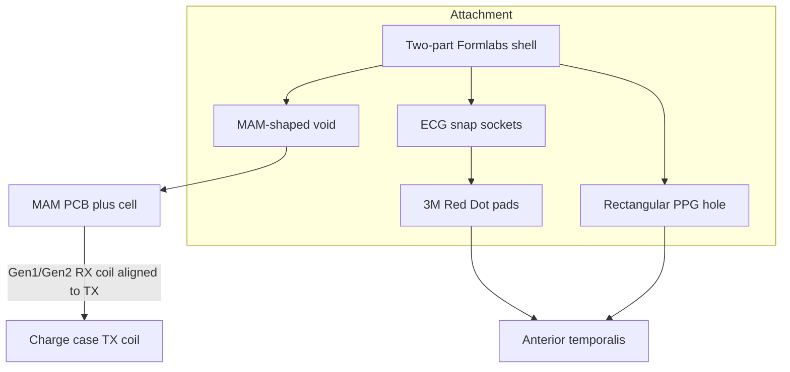

---

## 0b. Beacon loaner ops (initial use — Gen1 / Gen2)

Patient does **not** take the charge case home. John (or clinic) owns charge and housing seat.

This remove / reseat / coil-align loop is the **Gen1–Gen2** clinic path. **Gen4** ends it: **USB-C on the pod** charges the sealed (or closed) device without opening the housing or aligning RX/TX coils. Do **not** wait for Gen4 to run Beacon n≈5.

| Step | Who | Action |
|------|-----|--------|
| 1 | Clinic / John | Charge the **bare** MAM on the Oralable charge case (RX coil aligned with TX coil). A magnetic dock is a possible later case. |
| 2 | Clinic / John | Put the charged MAM into the printed housing (ventral + dorsal). |
| 3 | Clinic / John | Give housing + pads (Red Dots) to the user. |
| 4 | User | Wear one night on temple; return the device to Beacon. |
| 5 | Clinic / John | Open the housing, remove the MAM, download / QC as needed. |
| 6 | Clinic / John | Charge the MAM again on the case, then re-seat for the next night. |

**Do**

- Charge the MAM **out of** the housing for this Gen1/Gen2 loop (coil face free on the case).
- Keep the charge case at Beacon / with John — not in the patient’s bag.
- Treat the printed shell as the wear package the user sees; the bare board stays a clinic object.

**Do not**

- Expect the user to open the housing or align coils.
- Hold Beacon n≈5 until Gen4 USB-C exists — use this loop (or pads/tape on the current clip) now.
- Ask the user to charge anything at home.

Related use rules: [ORALABLE_RESEARCH_KIT.md](./data_room/clinical/ORALABLE_RESEARCH_KIT.md) · [ED_PEDRO_MEETING_2026-09-07.md](./data_room/clinical/ED_PEDRO_MEETING_2026-09-07.md).

---

## 1. Generations (attachment only)

Hardware gens remain **Gen1** (nRF52832 / BOM REV8 / PCB REV10) and **Gen2** (nRF54L15 / BOM REV9 / PCB REV11). **Gen4** is a combined-pod concept, not a BOM row.

| | Gen1 shell | Gen2 shell | Gen4 pod |
|--|------------|------------|----------|
| Status | Print now — lab / development | Print now — cavity for boards due early October | Concept — in development |
| Electronics in shell | MAM only | MAM only | MAM **plus** ANR-class EMG |
| Charge | Wireless: clip **LTC4124** RX coil aligned with charge-case **LTC6990** TX coil. A magnetic dock is a possible later case. **Not Qi.** Clinic: charge **bare** MAM, then seat (§0b). | Same | **USB-C on the pod** — clinic plugs the returned device; no bare-board remove / coil align |
| Print | Formlabs, two parts that slot, MAM-shaped void, rectangular PPG hole | Same method; **void follows Gen2 envelope** (small delta) | Later: EMG wells + USB-C strain; rubbery overmold is Gen4, not a Gen1 paint job |
| Skin attach | Red Dot snaps, no headband | Same | Same snaps; snaps also carry EMG |
| Loaner ops | Charge → seat → night → return → remove → recharge | Same | Charge on USB-C → night → return → recharge (housing stays closed) |

**Print both now.** Gen1 cavity for lab soak. Gen2 cavity ready for October boards. Do not hold Beacon n≈5 for the Gen2 print or for Gen4.

**Gen1 vs Gen2 envelope:** same outer M40-class capsule. Inner void changes with the board and cell (Gen1 **CG-320B** pin cell vs Gen2 **LP260820** pouch; BAT1 moves on REV11 — [PCB00003_GEN2_REV11_HARDWARE.md](./PCB00003_GEN2_REV11_HARDWARE.md)). Keep one Fusion outer with two inner voids.

**Gen4 solves the ops friction:** USB-C on the pod removes the bare-MAM charge step and the charge-case coil stack for the clinic loaner SKU. That is the intended fix for §0b — still a concept, not a ship gate.

Concept exploded view (geometry locked in SVG — PPG hole offset to U2, not capsule centre): 

*FIG-CO-063. Gen2 housing concept: Red Dots · ventral (snaps + **rectangular PPG window offset to U2 @ ~+10.8 mm**) · Gen2 MAM · dorsal. Not Fusion CAD. Real first print: FIG-CO-067 / FIG-CO-070.*

3D conformal cavity (boolean cut of MAM solids — not a flat rectangle): 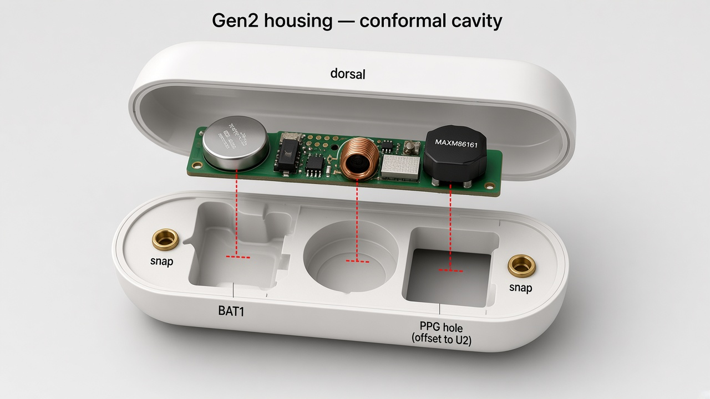

*FIG-CO-064. Gen2 housing concept 3D: dorsal · Gen2 MAM · ventral with **conformal** pockets for BAT1 / coil / U2 and PPG hole offset to U2. Concept only — cut the real STEP solids in Fusion.*

Version 4 mesh (`mam_gen2_version4_latest_for_cursor.stl`, not in git). Thin bar, 48 × 11 mm. This is not the M40 concept above and not the first-print photo (FIG-CO-067).

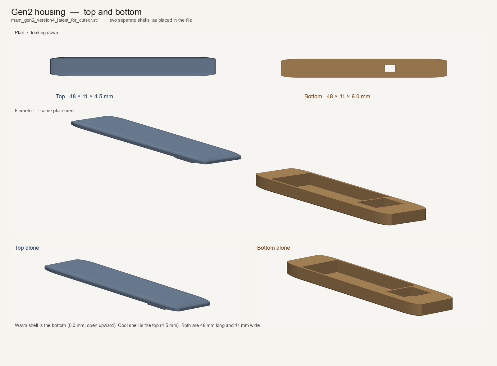

*FIG-CO-079. Both shells as placed in the file. Lid 48 × 11 × 4.5 mm. Tray 48 × 11 × 6.0 mm.*

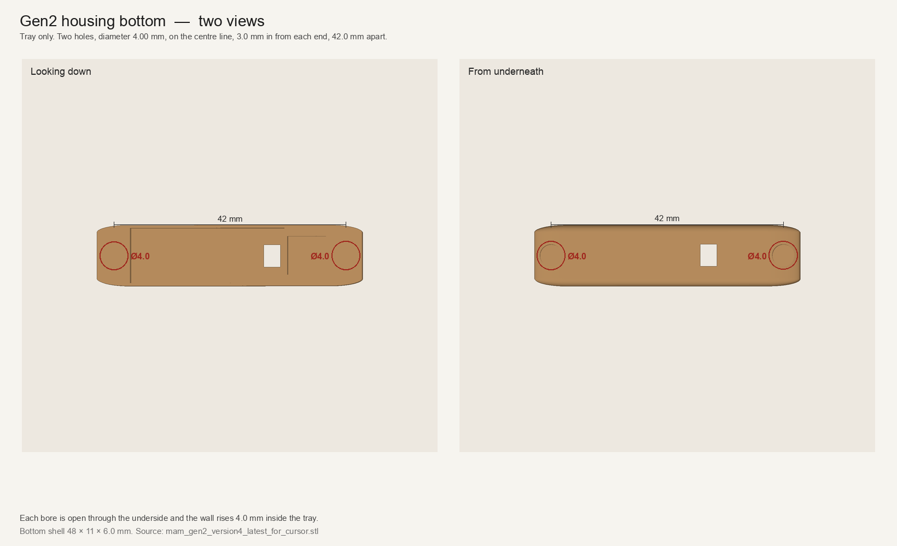

*FIG-CO-080. Bottom, looking down and from underneath. Two holes, Ø4.00 mm, on the centre line, 3.0 mm in from each end, 42.0 mm apart.*

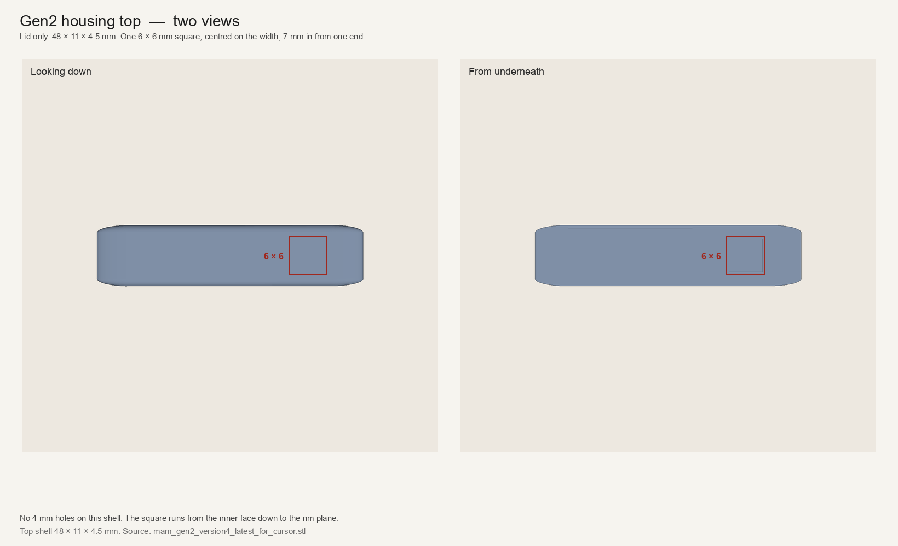

*FIG-CO-081. Top, looking down and from underneath. One 6 × 6 mm square, centred on the width, 7 mm in from one end.*

---

## 2. Photo read (15 Sep 2026)

Working photos of ANR M40 + Gen1 MAM (bare PCB labelled “Gen A”). Copy lives under `docs/figures/`.

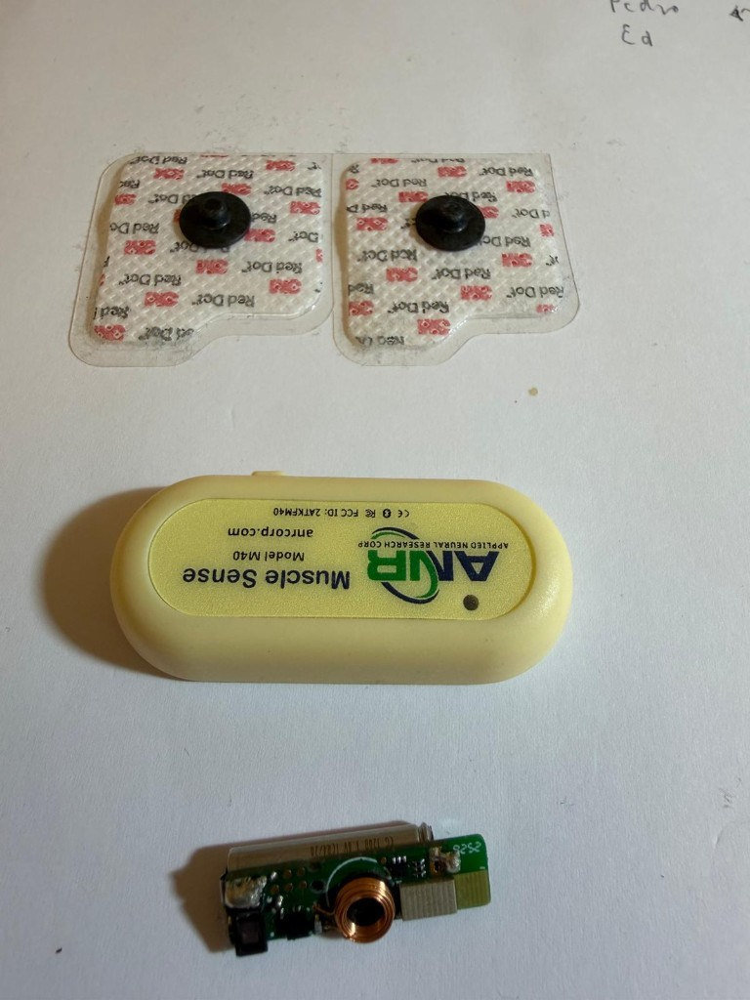

*FIG-CO-058. Target outer envelope is the M40 capsule, not the current Oralable clip. Two Red Dots; Gen1 MAM for scale.*

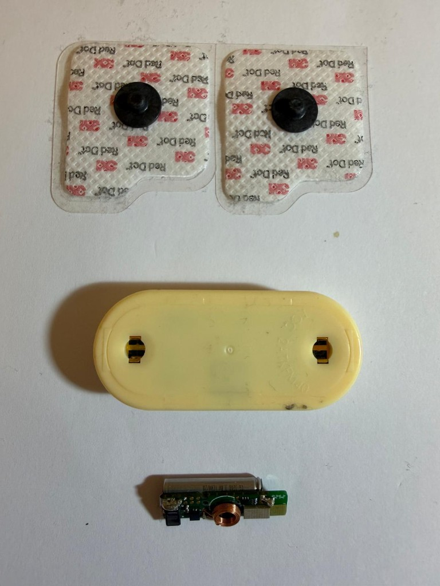

*FIG-CO-061. Two-part housing. Gold female snaps on the ventral shell. Snaps are hardware inserts, not printed contacts.*

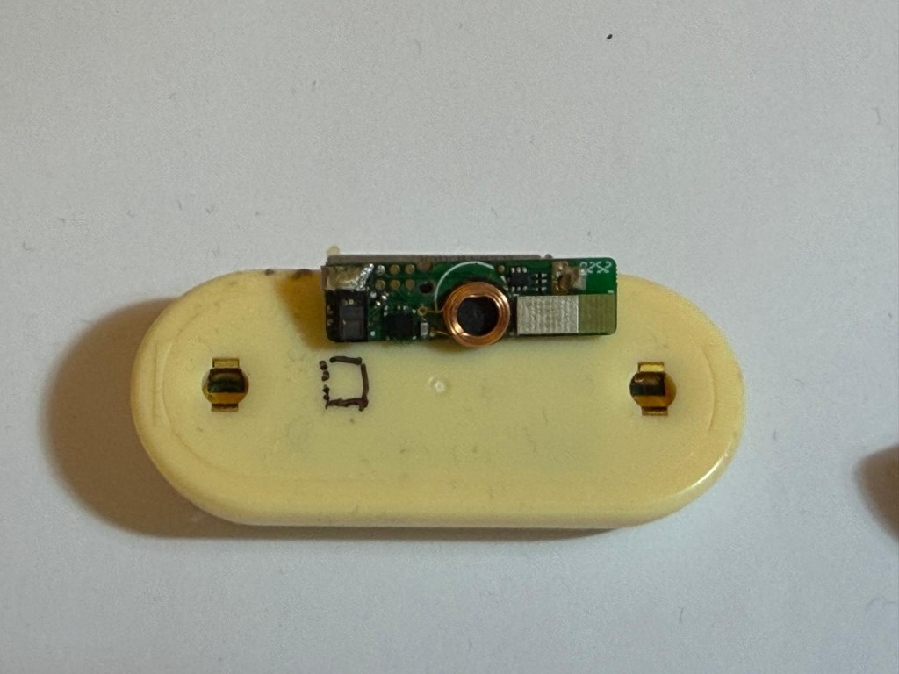

*FIG-CO-059. Black pen rectangle on the ventral shell: rectangular PPG hole, **offset along the long axis**, aligned to MAXM86161, not to the housing centroid.*

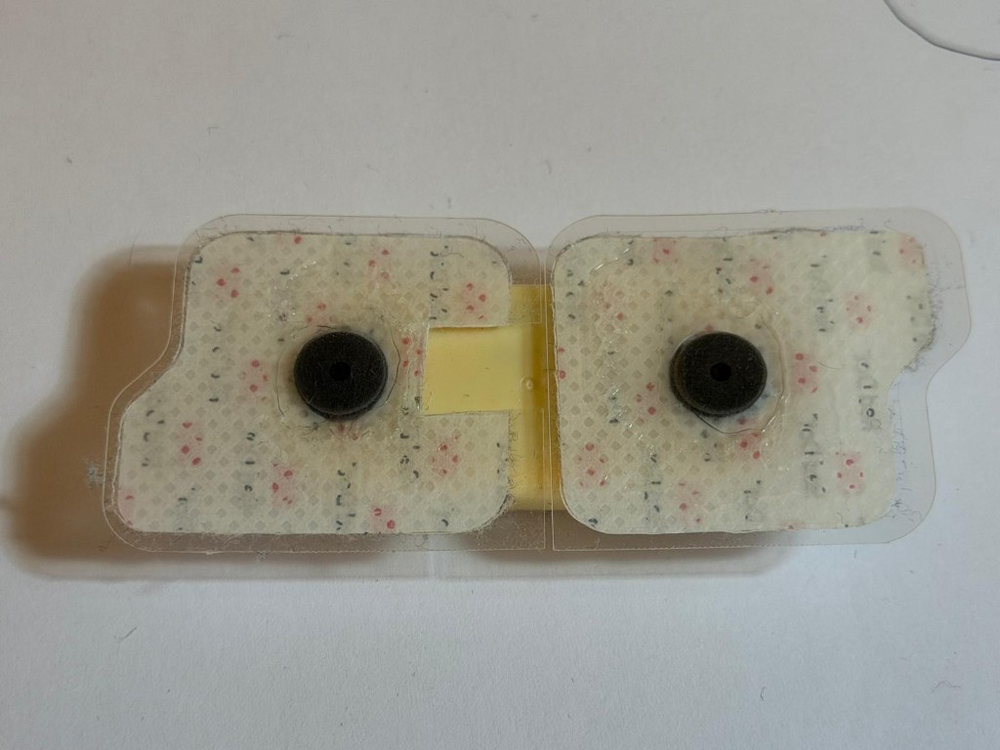

*FIG-CO-060. Pads leave a central gel-free strip. The PPG hole must land in that strip.*

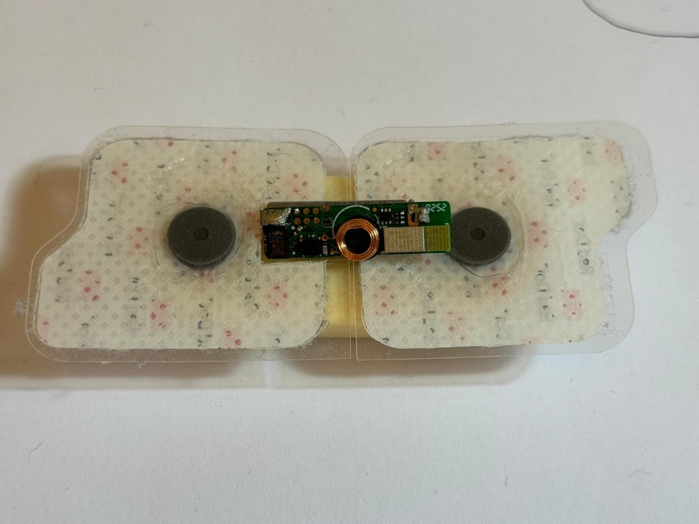

*FIG-CO-062. Gen1 board + cell + coil already fits between the two studs. Outer shell can stay M40-class; only the inner void and window move between Gen1 and Gen2.*

| ID | File | Design implication |
|----|------|--------------------|
| FIG-CO-058 | `FIG-CO-058-anr-m40-label-pads-mam.jpg` | Copy M40 length / width / height and snap spacing |
| FIG-CO-059 | `FIG-CO-059-ppg-window-mark.jpg` | Locate the window from the MAM origin (PPG package), then place the MAM so the hole sits between the snaps |
| FIG-CO-060 | `FIG-CO-060-red-dot-pad-gap.jpg` | Do not let pad gel cover LEDs / PD |
| FIG-CO-061 | `FIG-CO-061-anr-exploded-pads-shell-mam.jpg` | Print bosses; press-fit ECG snap sockets |
| FIG-CO-062 | `FIG-CO-062-mam-between-snaps.jpg` | Confirm the well is large enough before adding wall thickness |

**Parts on the Gen1 MAM (from photos):** cylindrical CG-320B, copper RX coil, black MAXM86161 optical face, green PCB. Coil and PPG share the skin / charge face. The housing must keep **both** that face toward skin **and** the RX coil free to sit over the charge-case TX coil (align coils on this build; a magnetic dock is a possible later case).

---

## 2b. Photo read (19 Sep 2026)

First Formlabs-class print of a Gen2 MAM housing, on the **same 3M Red Dot pads** as ANR. This print is a **thin white bar**, not the fat M40 stadium. Fusion outer target stays M40-class. Do not caption this bar as the finished capsule or as Beacon ship housing. Sources: [`docs/figures/attachment_photo_source/`](./figures/attachment_photo_source/). Full-face wear shots stay there; public wear figure is the hybrid.

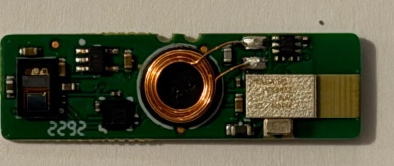

*FIG-CO-065. Bare Gen2 MAM PCB: copper RX coil, MAXM86161, gold antenna. No LP260820 pouch on this board.*

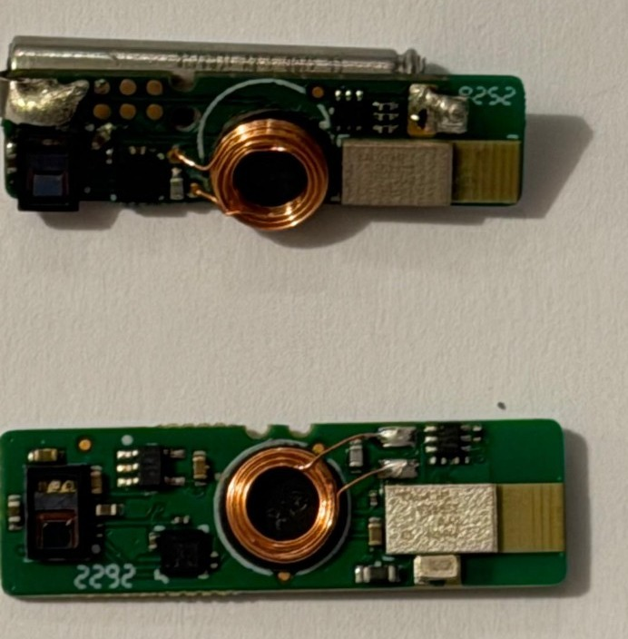

*FIG-CO-066. Gen1 MAM with CG-320B pin cell (top) vs bare Gen2 MAM (bottom).*

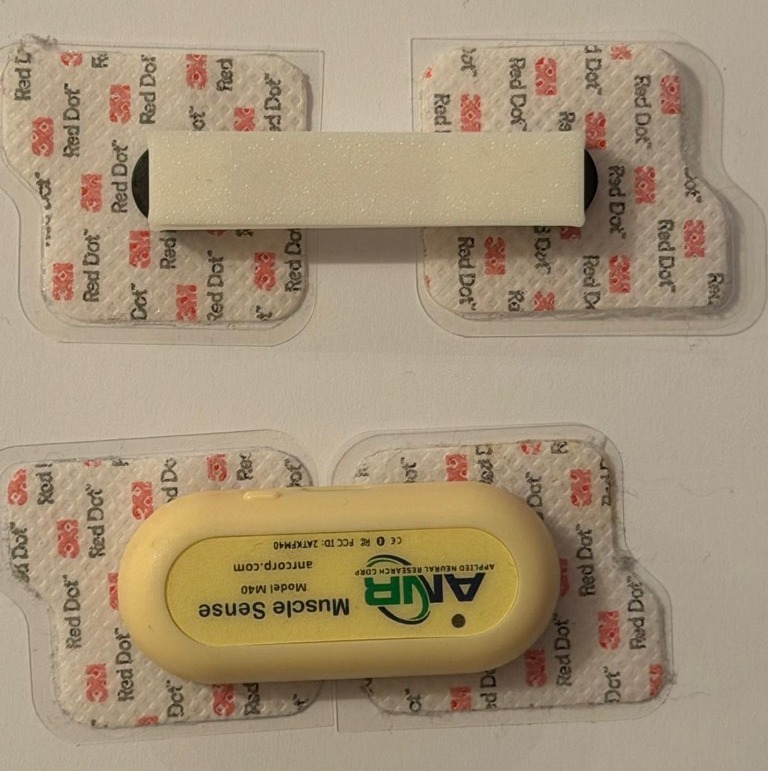

*FIG-CO-067. Same pad-and-snap class. Oralable first print = thin white bar. ANR M40 = cream stadium.*

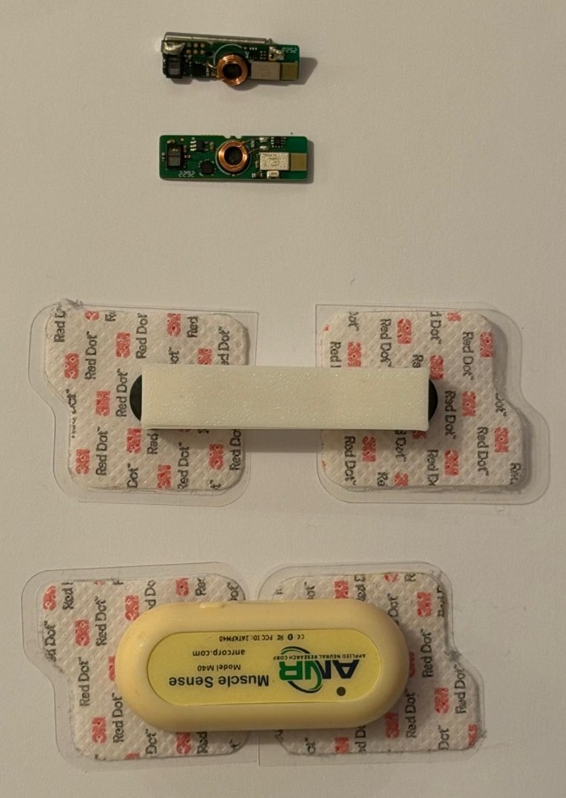

*FIG-CO-068. Scale: Gen1 MAM · Gen2 MAM · printed housing on Red Dots · ANR M40 on Red Dots.*

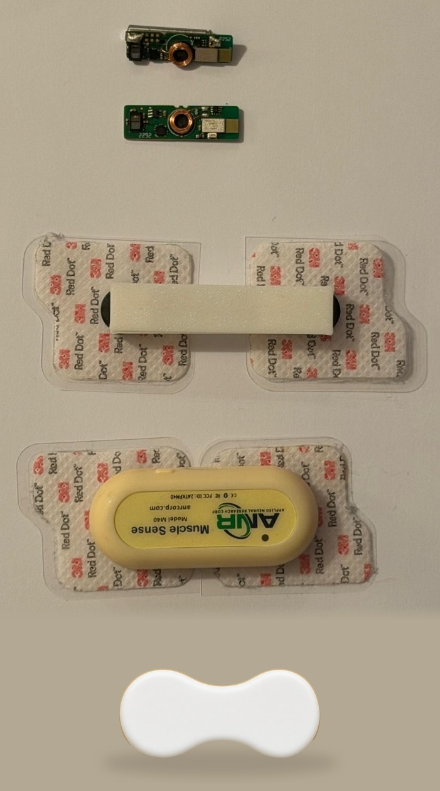

*FIG-CO-076. Copy of FIG-CO-068 with a Sunrise chin pod for size. Landscape peer only — not Dual A, not Beacon box.*

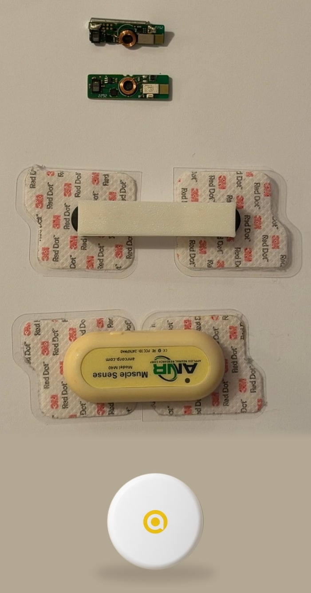

*FIG-CO-077. Copy of FIG-CO-068 with an AcuPebble neck disc (29 mm) for size. Attach-class peer — not Dual A, not Beacon box. Oralable ≠ AHI.*

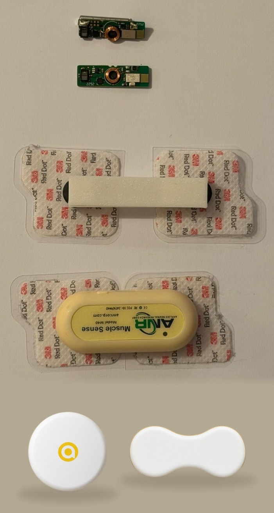

*FIG-CO-078. Copy of FIG-CO-068 with AcuPebble (left) and Sunrise (right). Oralable housing and ANR M40 stay from the photo. Size / attach peers only — not Dual A, not Beacon box. Oralable ≠ AHI.*

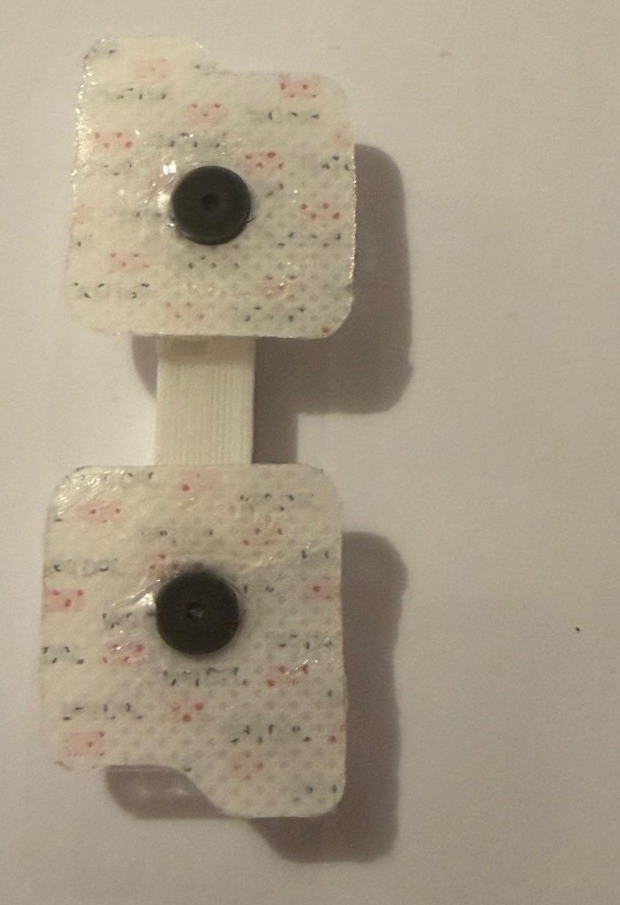

*FIG-CO-069. Same 3M Red Dot snap face as ANR (FIG-CO-060). White housing strip spans the pad gap.*

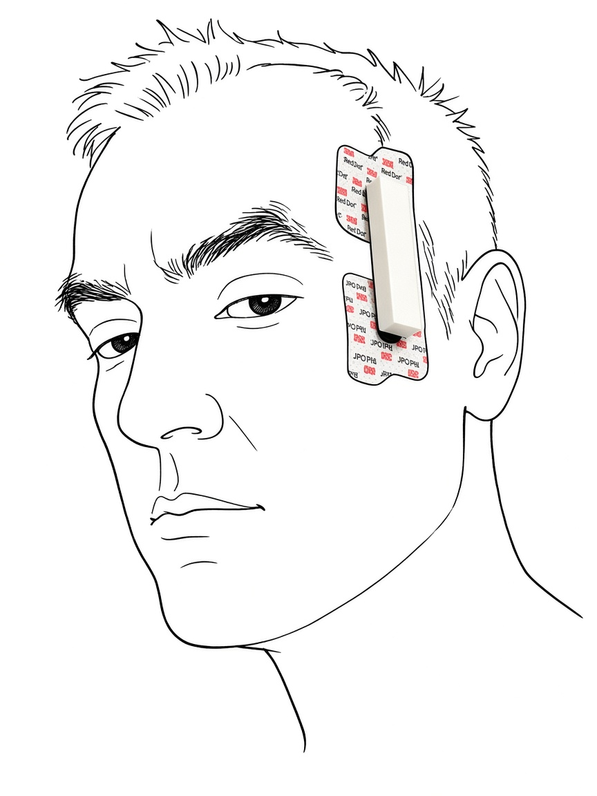

*FIG-CO-070. Matisse contour + photo Gen2 housing on Red Dots. Vertical on anterior temporalis. No Dual A, no headband. PPG window not on this dorsal face — FIG-CO-059 still owns the offset mark.*

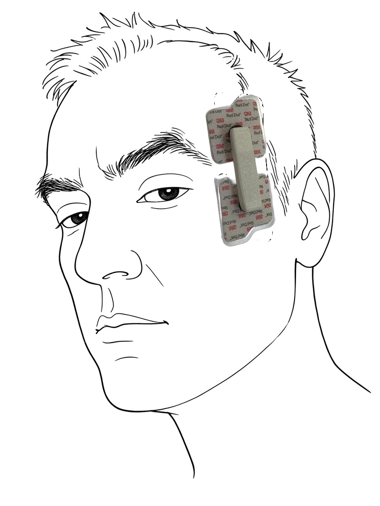

*FIG-CO-082. Same line face as FIG-CO-070. Photo is the 9 Oct printed housing on Red Dots. Vertical on anterior temporalis. No Dual A, no headband. PPG window not on this dorsal face.*

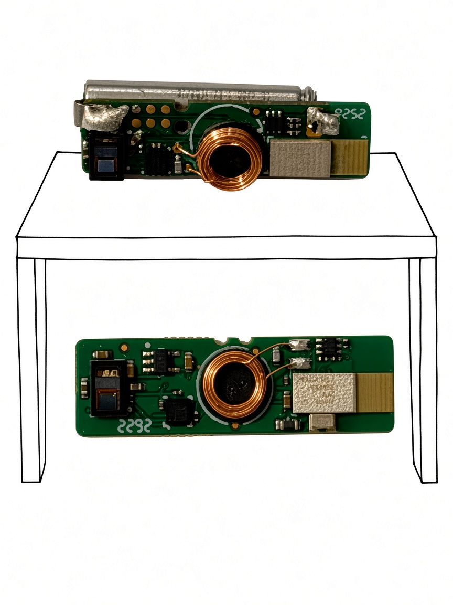

*FIG-CO-071. Line still-life + photo boards. Gen1 with cell above; bare Gen2 below.*

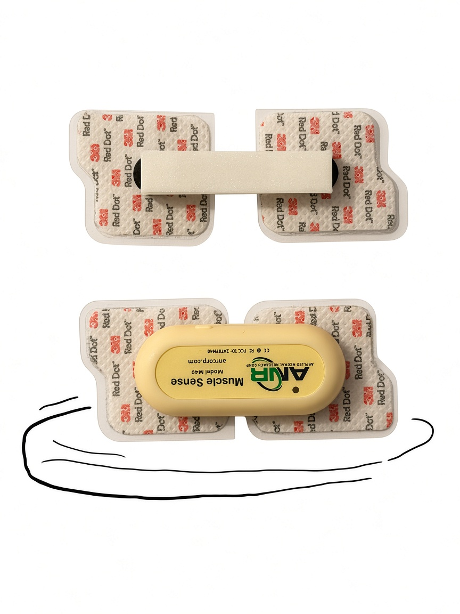

*FIG-CO-072. Line still-life + photo class match. Thin white bar above; ANR M40 below. Same Red Dots.*

| ID | File | Design implication |
|----|------|--------------------|
| FIG-CO-065 | `FIG-CO-065-gen2-mam-pcb.jpg` | Gen2 cavity must take coil + U2 with no cell on this board; pouch pocket still required for LP260820 |
| FIG-CO-066 | `FIG-CO-066-gen1-vs-gen2-mam.jpg` | Two inner voids, one outer. Gen1 cell sits on the long edge |
| FIG-CO-067 | `FIG-CO-067-gen2-housing-vs-anr-m40.jpg` | First print proves snap class. Outer is a bar, not yet the M40 stadium |
| FIG-CO-079 | `FIG-CO-079-gen2-v4-housing-shells.png` | v4 STL, both shells. 48 × 11 mm bar. Not the M40 outer |
| FIG-CO-080 | `FIG-CO-080-gen2-v4-bottom-two-views.png` | Bottom tray. Two Ø4.00 mm holes, 42 mm apart |
| FIG-CO-081 | `FIG-CO-081-gen2-v4-top-two-views.png` | Top lid. One 6 × 6 mm square |
| FIG-CO-068 | `FIG-CO-068-gen2-housing-scale-stack.jpg` | Board + housing + ANR in one frame for print / CAD |
| FIG-CO-076 | `FIG-CO-076-scale-stack-plus-sunrise.jpg` | Same frame + Sunrise pod for extraoral size. Not a housing sketch |
| FIG-CO-077 | `FIG-CO-077-scale-stack-plus-acupebble.jpg` | Same frame + AcuPebble disc (29 mm). Attach class, not AHI |
| FIG-CO-078 | `FIG-CO-078-scale-stack-four-extraoral.jpg` | Oralable housing · ANR · AcuPebble · Sunrise in one frame |
| FIG-CO-069 | `FIG-CO-069-red-dot-snap-housing.jpg` | Snap pitch and pad gap from the same electrodes as ANR |
| FIG-CO-070 | `FIG-CO-070-matisse-photo-gen2-housing-wear.png` | Temple sit without headband. Hybrid for decks; full-face photos stay source-only |
| FIG-CO-082 | `FIG-CO-082-matisse-photo-gen2-housing-9oct.png` | Same line face as 070. Photo is the 9 Oct closed housing |
| FIG-CO-071 | `FIG-CO-071-matisse-photo-gen1-gen2-mam.png` | Hybrid of 066 for partner pages |
| FIG-CO-072 | `FIG-CO-072-matisse-photo-housing-vs-anr.png` | Hybrid of 067 — lab/attachment, not the Beacon box |

---

## 3. Fusion 360 → Formlabs STL

Do not commit a guessed housing `.f3d`. Solids in git: [attachment_gen1_MAM.stl](./data_room/attachment/attachment_gen1_MAM.stl) · [PCB00003-TGM-STEP-REV11.step](./data_room/attachment/PCB00003-TGM-STEP-REV11.step). Fill remaining calipers in [data_room/attachment/README.md](./data_room/attachment/README.md).

### 3.1 Measure

| Item | What to record |
|------|----------------|
| M40 outer | Length, width, height; snap-to-snap pitch; snap hole ID; wall thickness |
| Gen1 MAM | **26.24 × 7.26 × 5.98 mm** (mesh AABB, mm) — [attachment_gen1_MAM.stl](./data_room/attachment/attachment_gen1_MAM.stl). Still need MAXM86161 window offset and coil OD. Mesh is not at origin. |
| Gen2 MAM | Clip island **~32 × 12 mm** XY from [PCB00003-TGM-STEP-REV11.step](./data_room/attachment/PCB00003-TGM-STEP-REV11.step). Full STEP is **82 mm** (includes charger half) — do not pocket that. Z ~22 mm is both CAD faces, not worn height. |

### 3.2 Model (one outer, two voids)

1. **Component `ANR_envelope`:** stadium sketch from the M40 outline; extrude overall height. Shared by Gen1 and Gen2.
2. **Component `ventral` (skin half):** shell it; add two snap bosses on the long axis at measured pitch; cut through-holes for press-fit ECG sockets.
3. **Component `dorsal`:** matching outer; **tongue-and-groove** (or slot-lip) around the split so the two prints assemble without screws for v1.
4. **Component `MAM_gen1` / `MAM_gen2`:** import [attachment_gen1_MAM.stl](./data_room/attachment/attachment_gen1_MAM.stl); move to housing origin. For Gen2, import [PCB00003-TGM-STEP-REV11.step](./data_room/attachment/PCB00003-TGM-STEP-REV11.step), hide the charger half (~47–69 mm), keep the clip island solids (`BAT1` / LP260820, `U2` MAXM86161, `U5`, `L1` / copper coil, PCB, nearby passives). Place PPG toward skin, coil toward skin.
5. **Cavity (conformal):** Combine / Cut the **actual Gen2 MAM solids** from the closed housing — not a rectangular pocket the size of the ~32×12 mm AABB. The void must follow the outline and heights of the board and its components (cell pouch, module, coil, optical package) with **0.2–0.4 mm** Formlabs clearance all around. Keep a pocket so the board cannot rotate off the PPG window. The AABB is planning only.
6. **PPG hole:** rectangular through-cut on the ventral face, sized to the MAXM86161 optical face (black-pen mark), with 0.3–0.5 mm extra for print error. Centre on the photodiode / LED package, **not** the housing centre. Keep the hole in the pad-gap strip.
7. **Coil:** no metal over the RX coil. Ventral wall over the coil as thin as the print allows so the MAM RX coil can align with the charge-case TX coil. Gold snaps stay outboard of the coil. Docking on this build is **coil alignment**. A magnetic dock is a possible later case.
8. **Export:** two STLs per gen (`*_ventral.stl`, `*_dorsal.stl`), 0.1 mm mesh.
9. **PreForm:** Form 3 / 3+. Start resin **Tough 1500** or Grey Pro for fit. Overnight skin later may need BioMed — do not claim biocompatibility from the first Grey print. Split plane on the build plate; keep supports off the window edge.

### 3.3 Fit risks

- Open rectangle (no glass) is correct for Gen1 / Gen2. Too large → stray light; too small → vignette. Soak metric is `couple` (unknown / 0 / 1 / 2).
- A thicker M40-class shell increases the RX–TX coil gap and can mis-align the coils. First print must pass a **charge-on-case** test (coils aligned), not only a temple sit.
- Gen1 vs Gen2: keep **one** outer Fusion file with two inner void configurations (parameter or derived component), not two unrelated models.
- Gen2 STEP is the full PCB00003 (clip + charger). Cut only the clip island. Do not use the 82 × 22 mm AABB as the pocket. Do not use a flat rectangle for the Gen2 void — cut the STEP solids so the cavity matches the MAM and its components.
- Gen4 CAD stays out of this print pass: EMG electrode wells recessed, PPG window proud of gel, USB-C on dorsal / end, analog isolation vs LEDs. Pointer: [ED_PEDRO_MEETING_2026-09-07.md](./data_room/clinical/ED_PEDRO_MEETING_2026-09-07.md) §1.8–1.9.

---

## 4. Print and soak checklist

| # | Check | Pass |
|---|-------|------|
| 1 | Gen1 ventral + dorsal slot together; MAM does not rattle over the window | ☐ |
| 2 | Rectangular hole centred on MAXM86161; no pad gel in the optical path | ☐ |
| 3 | Charge the **bare** MAM on the Oralable case (RX aligned with TX), then seat it in the housing. A magnetic dock is a possible later case | ☐ |
| 3b | *Optional eng soak:* charge through the printed shell (coil gap / stray metal check) | ☐ |
| 4 | Red Dots snap on; temple sit without headband | seen in photo (FIG-CO-067 / 070); soak still open |
| 5 | `couple` logged 30–60 min (4 h better) | ☐ |
| 6 | Repeat 1–2 with the Gen2 void (empty or dummy) so October boards drop in | ☐ |

---

## 5. Do not

- Invent a new silhouette. Copy the M40 capsule class. The 19 Sep print is a thin bar for sit and snap; do not treat that bar as the finished Fusion outer.
- Put metal over the RX coil or gel over the PPG hole.
- Tell users to charge on a phone Qi pad, or to take the charge case home.
- Ask the user to open the housing or remove the MAM for charge.
- Call Gen4 a hardware BOM generation.
- Rewrite VERSION_ALIGNMENT / Research Kit “ship Gen1” language from this topic.
- Paste patent claim text or provisional specification wording.
- Treat a Grey Pro fit print as a biocompatible overnight housing.

---

## 6. Related

| Doc | Role |
|-----|------|
| [PRODUCT_ROADMAP.md](./PRODUCT_ROADMAP.md) §1 | PCB / BOM / charge case (coil align now; magnetic dock later) |
| [data_room/clinical/ORALABLE_RESEARCH_KIT.md](./data_room/clinical/ORALABLE_RESEARCH_KIT.md) | Beacon box: pads/tape today |
| [data_room/clinical/TEMPORALIS_ANATOMY_AND_PLACEMENT.md](./data_room/clinical/TEMPORALIS_ANATOMY_AND_PLACEMENT.md) | Where on the temple |
| [ANR_M40_CONCORDANCE.md](./ANR_M40_CONCORDANCE.md) | Dual A lab (not Beacon patient attach) |
| [data_room/hardware/HW_ENGINEER_ALTIUM_BRIEF.md](./data_room/hardware/HW_ENGINEER_ALTIUM_BRIEF.md) | Envelope class ~20×7×4 mm (PCB), not this shell |
