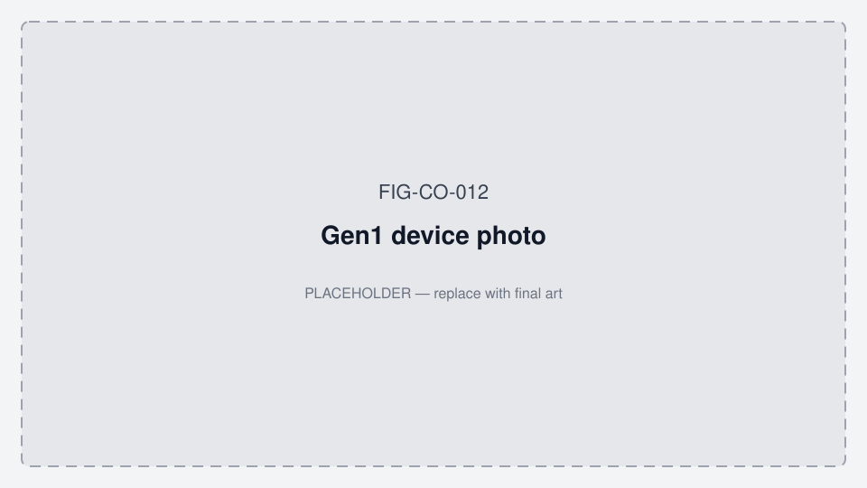

# Oralable figures inventory (master)

**Hub for all four repos.** Mermaid stays inline in Markdown for flows/architecture. Named SVG/PNG under `docs/figures/` for anatomy, product, hardware photos, and UI mocks. Status: `placeholder` | `draft` | `final`.

**Sibling indexes:** [oralable_nrf/docs/FIGURES.md](../../oralable_nrf/docs/FIGURES.md) · [oralable_swift/docs/FIGURES.md](../../oralable_swift/docs/FIGURES.md) · [OralableCore/docs/FIGURES.md](../../OralableCore/docs/FIGURES.md)

**Patient app working diagrams:** Mermaid in [oralable_swift/docs/MOBILE_APP_FLOWS.md §2](../../oralable_swift/docs/MOBILE_APP_FLOWS.md#2-how-the-patient-app-works--phase-0). Draft wireframes `FIG-IOS-001`…`009` live in [oralable_swift/docs/figures/](../../oralable_swift/docs/figures/) — index [oralable_swift/docs/FIGURES.md](../../oralable_swift/docs/FIGURES.md). Also mirrored in [ORALABLE_SYSTEM_MAP_DIAGRAMS.md §8](./ORALABLE_SYSTEM_MAP_DIAGRAMS.md).

**Brand (not numbered FIG):** [data_room/brand/](./data_room/brand/) — logo lockups only.

**Pitch self-contained copies:** [data_room/figures/](./data_room/figures/) — same IDs as shared research figures when decks need local paths.

## Maintenance

1. New diagram → add a row here **first**, then embed.
2. Replace art by overwriting the same filename; flip status; keep caption ID stable.
3. Pitch HTML/PDF regen uses `data_room/figures/` + `data_room/brand/`; do not invent one-off slide-only names.
4. Do not put confidential claim text in SVG titles meant for external decks.
5. Clinical raw plots live under `data/plots/`; promote selected embeds here as `FIG-CO-xxx` (symlink path or copy later).


## Canonical vs style variants

**Diligence / decks use the paths in the inventory table above** (and symlinks under `data_room/figures/`).

Style exploration folders under `docs/figures/` (e.g. matisse / hokusai / durer / photo_source working crops) are **not** investor diligence. Keep one canonical file per FIG-CO-ID in the table; cull unused variants in a later dedicated pass after picking winners. See also [VISUAL_AND_VOICE_DIRECTION.md](./data_room/brand/VISUAL_AND_VOICE_DIRECTION.md).

## Template

Copy [`figures/_placeholder.svg`](./figures/_placeholder.svg) → `FIG-CO-NNN-slug.svg`, update the three text lines inside the SVG, then embed:

```markdown


*Figure FIG-CO-012 — Gen1 device photo (placeholder).*
```

## Inventory — cursor_oralable (`FIG-CO-*`)

| ID | Title | Path | Status | Owning doc(s) | Notes |
|----|-------|------|--------|---------------|-------|
| FIG-CO-001 | Stage A → Stage B pathway | [figures/FIG-CO-001-stage-ab-pathway.svg](./figures/FIG-CO-001-stage-ab-pathway.svg) | placeholder | IP_NORTH_STAR | Prefer Mermaid in-doc; SVG optional for decks |
| FIG-CO-002 | Patent embodiment stack | [figures/FIG-CO-002-patent-embodiment-stack.svg](./figures/FIG-CO-002-patent-embodiment-stack.svg) | placeholder | IP_NORTH_STAR | Block art for embodiment layers |
| FIG-CO-003 | Temporalis clip placement | [figures/FIG-CO-003-temple-placement.svg](./figures/FIG-CO-003-temple-placement.svg) | placeholder | TEMPORALIS_COLLECTION_PROTOCOL, ED_PEDRO_QUICK_START, data_room/figures | Replace with temple photo |
| FIG-CO-004 | Protocol B 3-tap sync | [figures/FIG-CO-004-three-tap-sync.svg](./figures/FIG-CO-004-three-tap-sync.svg) | placeholder | TEMPORALIS_COLLECTION_PROTOCOL | Accel spike sketch |
| FIG-CO-005 | Protocol A 5-tap sync | [figures/FIG-CO-005-protocol-a-five-tap.svg](./figures/FIG-CO-005-protocol-a-five-tap.svg) | placeholder | TEMPORALIS_COLLECTION_PROTOCOL | Training cohort |
| FIG-CO-006 | IR-DC occlusion trough | [figures/FIG-CO-006-ir-dc-occlusion-trough.svg](./figures/FIG-CO-006-ir-dc-occlusion-trough.svg) | placeholder | ALGORITHM_ARCHITECTURE, IR_DC_ADC_FORMAT | Cross-check clench vs DC trough |
| FIG-CO-007 | 50 Hz PPG pipeline | [figures/FIG-CO-007-ppg-50hz-pipeline.svg](./figures/FIG-CO-007-ppg-50hz-pipeline.svg) | placeholder | ALGORITHM_ARCHITECTURE | Mermaid preferred in-doc |
| FIG-CO-008 | Overnight night report layout | [figures/FIG-CO-008-night-report-layout.svg](./figures/FIG-CO-008-night-report-layout.svg) | placeholder | OVERNIGHT_NIGHT_REPORT | PDF/UI mock |
| FIG-CO-009 | Oralable_7 from sync1 | [figures/FIG-CO-009-oralable7-from-sync1.svg](./figures/FIG-CO-009-oralable7-from-sync1.svg) | placeholder | CLINICAL_VALIDATION | Promote `data/plots/.../oralable7_from_sync1.png` |
| FIG-CO-010 | Oralable_7 validation dashboard | [figures/FIG-CO-010-oralable7-validation-dashboard.svg](./figures/FIG-CO-010-oralable7-validation-dashboard.svg) | placeholder | CLINICAL_VALIDATION | Promote `.../oralable7_validation_dashboard.png` |
| FIG-CO-011 | Extraoral vs intraoral | [figures/FIG-CO-011-extraoral-vs-intraoral.svg](./figures/FIG-CO-011-extraoral-vs-intraoral.svg) | placeholder | LITERATURE_AND_PRIOR_ART, COLLAB_NABAVI_MCGILL, data_room/figures | Oralable temple vs Dianyx intraoral |
| FIG-CO-012 | Gen1 device photo | [figures/FIG-CO-012-gen1-device-photo.svg](./figures/FIG-CO-012-gen1-device-photo.svg) | placeholder | HW_ENGINEER_ALTIUM_BRIEF, pitches | BOM REV8 / PCB REV10 |
| FIG-CO-013 | Charge case / research dock | [figures/FIG-CO-013-research-charge-dock.png](./figures/FIG-CO-013-research-charge-dock.png) · SVG stub [FIG-CO-013-magnetic-case.svg](./figures/FIG-CO-013-magnetic-case.svg) | draft photo | ORALABLE_RESEARCH_KIT, PEDRO, pitches | Oralable in research dock (wa11 crop). This build is coil alignment. A magnetic dock is a possible later case. SVG filename is historical. |
| FIG-CO-014 | PCB REV10 photo | [figures/FIG-CO-014-pcb-rev10-photo.svg](./figures/FIG-CO-014-pcb-rev10-photo.svg) | placeholder | PCB00003_GEN2_REV11_HARDWARE, HW brief | |
| FIG-CO-015 | Altium board overview | [figures/FIG-CO-015-altium-board-overview.svg](./figures/FIG-CO-015-altium-board-overview.svg) | placeholder | HW_ENGINEER_ALTIUM_BRIEF | From Wout / WeeGee |
| FIG-CO-016 | Oralable Research Kit contents | [figures/FIG-CO-016-research-kit-flatlay.png](./figures/FIG-CO-016-research-kit-flatlay.png) · SVG stub [FIG-CO-016-ed-pedro-kit-contents.svg](./figures/FIG-CO-016-ed-pedro-kit-contents.svg) | draft photo | ORALABLE_RESEARCH_KIT, PITCH_PEDRO_ED_FF, PAPER_A | wa10 flat-lay; see [RESEARCH_KIT_PHOTO_SELECTION.md](./data_room/clinical/RESEARCH_KIT_PHOTO_SELECTION.md) |
| FIG-CO-017 | Cheek vs temple sites | [figures/FIG-CO-017-cheek-vs-temple-sites.svg](./figures/FIG-CO-017-cheek-vs-temple-sites.svg) | placeholder | TEMPORALIS_COLLECTION_PROTOCOL, PRODUCT_ROADMAP | Pilot = temple |
| FIG-CO-018 | SASHB bout example | [figures/FIG-CO-018-sashb-bout-example.svg](./figures/FIG-CO-018-sashb-bout-example.svg) | placeholder | CLINICAL_VALIDATION, ALGORITHM_ARCHITECTURE | |
| FIG-CO-019 | Overnight hypnogram bands | [figures/FIG-CO-019-hypnogram-bands.svg](./figures/FIG-CO-019-hypnogram-bands.svg) | placeholder | OVERNIGHT_NIGHT_REPORT | Band chips stub; pair with FIG-CO-025 |
| FIG-CO-020 | Core ML MAM flow | [figures/FIG-CO-020-coreml-mam-flow.svg](./figures/FIG-CO-020-coreml-mam-flow.svg) | placeholder | ALGORITHM_ARCHITECTURE, CORE_ML_TRAINING_COHORT | Cross-link FIG-CORE-* |
| FIG-CO-021 | Temple lifestyle photo | [figures/FIG-CO-021-system-stack-photo.svg](./figures/FIG-CO-021-system-stack-photo.svg) | placeholder | pitches, GTM | External-safe |
| FIG-CO-022 | Charge-to-temple flow | [figures/FIG-CO-022-pilot-charge-to-temple.svg](./figures/FIG-CO-022-pilot-charge-to-temple.svg) | placeholder | ED_PEDRO_QUICK_START, PILOT_DRY_RUN | |
| FIG-CO-023 | Tape vs silicone potting | [figures/FIG-CO-023-silicone-vs-tape.svg](./figures/FIG-CO-023-silicone-vs-tape.svg) | placeholder | HW_ENGINEER_ALTIUM_BRIEF, LITERATURE | Pilot = tape |
| FIG-CO-024 | BruxScreen intake stub | [figures/FIG-CO-024-bruxscreen-intake.svg](./figures/FIG-CO-024-bruxscreen-intake.svg) | placeholder | CLINICAL_VALIDATION, TEMPORALIS_COLLECTION_PROTOCOL | Literature tool — not Oralable UI |
| FIG-CO-025 | State hypnogram exemplar | [figures/FIG-CO-025-state-hypnogram-exemplar.png](./figures/FIG-CO-025-state-hypnogram-exemplar.png) | final (layout) | OVERNIGHT_NIGHT_REPORT, TEMPORALIS_COLLECTION_PROTOCOL, PRODUCT_ROADMAP, MOBILE_APP_FLOWS, PAPER_A | **Very useful overnight measure** — from `TEMPORALIS_20260724/02_state_hypnogram.png`; wear in that pack ≈ **6 min** (not ≥6 h night) — layout/states only until true overnight; in-app `StateHypnogramView` / FIG-IOS-003 |
| FIG-CO-026 | ANR M40 + Red Dots | [figures/FIG-CO-026-anr-m40.png](./figures/FIG-CO-026-anr-m40.png) · SVG stub [FIG-CO-026-anr-m40.svg](./figures/FIG-CO-026-anr-m40.svg) | draft photo | ORALABLE_RESEARCH_KIT, ANR_M40, PAPER_A, PITCH | wa12 |
| FIG-CO-027 | Bruxoff | [figures/FIG-CO-027-bruxoff.svg](./figures/FIG-CO-027-bruxoff.svg) | placeholder | BRUXOFF_PSG_GOLD_STANDARD, PAPER_A, PITCH_PEDRO_ED_FF | **Ask Pedro** / fair-use |
| FIG-CO-028 | AcuPebble | [figures/FIG-CO-028-acupebble.svg](./figures/FIG-CO-028-acupebble.svg) | placeholder | ACUPEBBLE_VS_ORALABLE_ANR, PAPER_A, PITCH_PEDRO_ED_FF | **Ask Pedro** (SKU) |
| FIG-CO-029 | GrindCare | [figures/FIG-CO-029-grindcare.svg](./figures/FIG-CO-029-grindcare.svg) | placeholder | LITERATURE_AND_PRIOR_ART, PAPER_A, PITCH_PEDRO_ED_FF | fair-use |
| FIG-CO-030 | Oralable PPG module close-up | [figures/FIG-CO-030-oralable-ppg-module.png](./figures/FIG-CO-030-oralable-ppg-module.png) | draft photo | PAPER_A methods, pitches | wa14 — research PCB, not Gen1 clip |
| FIG-CO-031 | Dual A ANR vertical temple | [figures/FIG-CO-031-dual-a-anr-vertical-temple.png](./figures/FIG-CO-031-dual-a-anr-vertical-temple.png) | draft photo | PAPER_A, PEDRO, PITCH | wa03 temple crop |
| FIG-CO-032 | Oralable + silicone on temporalis | [figures/FIG-CO-032-oralable-silicone-temple.png](./figures/FIG-CO-032-oralable-silicone-temple.png) | draft photo | PEDRO, PAPER_A | wa05 temple crop |
| FIG-CO-033 | Dual A headband worn | [figures/FIG-CO-033-dual-a-headband-worn.png](./figures/FIG-CO-033-dual-a-headband-worn.png) | draft photo | PEDRO, PAPER_A coupling | wa01 temple crop |
| FIG-CO-034 | Evolsin silicone materials | [figures/FIG-CO-034-evolsin-silicone-materials.png](./figures/FIG-CO-034-evolsin-silicone-materials.png) | draft photo | PEDRO materials | wa08 box crop |
| FIG-CO-035 | Kapton position lock | [figures/FIG-CO-035-kapton-position-lock.svg](./figures/FIG-CO-035-kapton-position-lock.svg) | placeholder | ORALABLE_RESEARCH_KIT §2b | **Need** Kapton close-up photo |
| FIG-CO-036 | Dual A layer-cake diagram | [figures/FIG-CO-036-dual-a-layer-cake-diagram.svg](./figures/FIG-CO-036-dual-a-layer-cake-diagram.svg) | placeholder | PAPER_A, PEDRO, PITCH | Labeled stack graphic TBD |
| FIG-CO-037 | Gen1 clip product photo | [figures/FIG-CO-037-gen1-clip-product-photo.svg](./figures/FIG-CO-037-gen1-clip-product-photo.svg) | placeholder | pitches, ED_PEDRO_QUICK_START | Finished clip beauty shot TBD |
| FIG-CO-054 | Hybrid Dual A visual (locked direction) | [figures/FIG-CO-054-matisse-photo-dual-a-stack.png](./figures/FIG-CO-054-matisse-photo-dual-a-stack.png) | draft hybrid | ORALABLE_RESEARCH_KIT, PEDRO, PAPER_A, pitches | **Locked 7 Aug 2026:** Matisse contour face + photo Oralable/ANR · style bible [VISUAL_AND_VOICE_DIRECTION.md](./data_room/brand/VISUAL_AND_VOICE_DIRECTION.md) · catalog [RESEARCH_KIT_PHOTO_SELECTION.md](./data_room/clinical/RESEARCH_KIT_PHOTO_SELECTION.md) |
| FIG-CO-055 | Hybrid Oralable finger-press | [figures/FIG-CO-055-matisse-photo-oralable-finger-press.png](./figures/FIG-CO-055-matisse-photo-oralable-finger-press.png) | draft hybrid | PAPER_A placement, PEDRO, pitches | Matisse contour from FIG-CO-046 + photo Oralable silicone (wa15 / comp_05); PPG toward skin on temporalis · 054 recipe |
| FIG-CO-056 | Temporalis — anterior elevate | [figures/FIG-CO-056-temporalis-anterior-elevate.png](./figures/FIG-CO-056-temporalis-anterior-elevate.png) | draft (Oralable schematic) | TEMPORALIS_ANATOMY_AND_PLACEMENT, Paper A Fig. 2(a), Dual A seat | Vertical anterior fibers elevate mandible — **primary PPG/ANR site** · Kenhub cite for facts; stills in `research_kit_photo_source/kenhub_*` |
| FIG-CO-057 | Temporalis — posterior retract | [figures/FIG-CO-057-temporalis-posterior-retract.png](./figures/FIG-CO-057-temporalis-posterior-retract.png) | draft (Oralable schematic) | TEMPORALIS_ANATOMY_AND_PLACEMENT, Paper A Fig. 2(b) | Horizontal posterior fibers retract — **not** primary Dual A site |
| FIG-CO-058 | ANR M40 label + Red Dots + Gen1 MAM | [figures/FIG-CO-058-anr-m40-label-pads-mam.jpg](./figures/FIG-CO-058-anr-m40-label-pads-mam.jpg) | draft photo | ATTACHMENT | Outer envelope = M40 capsule |
| FIG-CO-059 | PPG hole mark on ventral shell | [figures/FIG-CO-059-ppg-window-mark.jpg](./figures/FIG-CO-059-ppg-window-mark.jpg) | draft photo | ATTACHMENT | Black pen rectangle; offset to MAXM86161 |
| FIG-CO-060 | Red Dot pad gap | [figures/FIG-CO-060-red-dot-pad-gap.jpg](./figures/FIG-CO-060-red-dot-pad-gap.jpg) | draft photo | ATTACHMENT | Gel-free strip for PPG hole |
| FIG-CO-061 | Exploded pads / ventral shell / MAM | [figures/FIG-CO-061-anr-exploded-pads-shell-mam.jpg](./figures/FIG-CO-061-anr-exploded-pads-shell-mam.jpg) | draft photo | ATTACHMENT | Snap inserts; two-part housing |
| FIG-CO-062 | MAM between snap studs | [figures/FIG-CO-062-mam-between-snaps.jpg](./figures/FIG-CO-062-mam-between-snaps.jpg) | draft photo | ATTACHMENT | Gen1 board fits M40 well |
| FIG-CO-063 | Gen2 housing — PPG offset to U2 | [figures/FIG-CO-063-gen2-housing-concept.svg](./figures/FIG-CO-063-gen2-housing-concept.svg) · [PNG](./figures/FIG-CO-063-gen2-housing-concept.png) | draft concept | ATTACHMENT | Rectangular PPG window **offset to U2 (~+10.8 mm)**, not capsule centre · real first print is FIG-CO-067 / 070 |
| FIG-CO-064 | Gen2 housing — conformal cavity 3D | [figures/FIG-CO-064-gen2-conformal-cavity-3d.png](./figures/FIG-CO-064-gen2-conformal-cavity-3d.png) | draft concept | ATTACHMENT | Boolean-cut cavity follows BAT1 / coil / U2 — not a flat rectangle; not Fusion CAD from STEP |
| FIG-CO-065 | Gen2 MAM PCB (bare) | [figures/FIG-CO-065-gen2-mam-pcb.jpg](./figures/FIG-CO-065-gen2-mam-pcb.jpg) | draft photo | ATTACHMENT | No pouch on this board · 19 Sep 2026 |
| FIG-CO-066 | Gen1 vs Gen2 MAM boards | [figures/FIG-CO-066-gen1-vs-gen2-mam.jpg](./figures/FIG-CO-066-gen1-vs-gen2-mam.jpg) | draft photo | ATTACHMENT | Gen1 + CG-320B · bare Gen2 |
| FIG-CO-067 | Gen2 housing vs ANR M40 | [figures/FIG-CO-067-gen2-housing-vs-anr-m40.jpg](./figures/FIG-CO-067-gen2-housing-vs-anr-m40.jpg) | draft photo | ATTACHMENT | Same Red Dot class · first print is a thin bar, not M40 stadium |
| FIG-CO-068 | Scale stack (boards + housing + ANR) | [figures/FIG-CO-068-gen2-housing-scale-stack.jpg](./figures/FIG-CO-068-gen2-housing-scale-stack.jpg) | draft photo | ATTACHMENT | Gen1 MAM · Gen2 MAM · printed housing · ANR M40 |
| FIG-CO-069 | Red Dot snap face + housing strip | [figures/FIG-CO-069-red-dot-snap-housing.jpg](./figures/FIG-CO-069-red-dot-snap-housing.jpg) | draft photo | ATTACHMENT | Same pads as ANR / FIG-CO-060 |
| FIG-CO-070 | Hybrid Gen2 housing wear | [figures/FIG-CO-070-matisse-photo-gen2-housing-wear.png](./figures/FIG-CO-070-matisse-photo-gen2-housing-wear.png) | draft hybrid | ATTACHMENT, pitches | Matisse contour + **photo** printed housing on Red Dots · 052 recipe · not Beacon ship |
| FIG-CO-071 | Hybrid Gen1 vs Gen2 MAM | [figures/FIG-CO-071-matisse-photo-gen1-gen2-mam.png](./figures/FIG-CO-071-matisse-photo-gen1-gen2-mam.png) | draft hybrid | ATTACHMENT | Line still-life + photo boards |
| FIG-CO-072 | Hybrid housing vs ANR | [figures/FIG-CO-072-matisse-photo-housing-vs-anr.png](./figures/FIG-CO-072-matisse-photo-housing-vs-anr.png) | draft hybrid | ATTACHMENT | Line still-life + photo class match · lab/attachment, not Beacon box |
| FIG-CO-073 | Hybrid Gen2 housing + Sunrise chin | [figures/FIG-CO-073-matisse-photo-gen2-housing-sunrise-chin.png](./figures/FIG-CO-073-matisse-photo-gen2-housing-sunrise-chin.png) | draft hybrid | ORALABLE_MARKET_LANDSCAPE, RESEARCH_KIT, pitches | Copy of 070 + **photo** Sunrise on chin · temple vs chin site contrast · not Dual A, not Beacon box |
| FIG-CO-074 | Hybrid Gen2 housing + Sunrise chin (clean pod) | [figures/FIG-CO-074-matisse-photo-gen2-housing-sunrise-chin-clean.png](./figures/FIG-CO-074-matisse-photo-gen2-housing-sunrise-chin-clean.png) | draft hybrid | ORALABLE_MARKET_LANDSCAPE, RESEARCH_KIT, pitches | Same sit as 073; Sunrise pod without the chin speck · not Dual A, not Beacon box |
| FIG-CO-075 | Hybrid 070 + Sunrise chin | [figures/FIG-CO-075-matisse-photo-070-plus-sunrise-chin.png](./figures/FIG-CO-075-matisse-photo-070-plus-sunrise-chin.png) | draft hybrid | ORALABLE_MARKET_LANDSCAPE, RESEARCH_KIT, pitches | FIG-CO-070 MAM stack kept · photo Sunrise on chin · Matisse line, no added colour · not Dual A, not Beacon box |
| FIG-CO-076 | Scale stack + Sunrise | [figures/FIG-CO-076-scale-stack-plus-sunrise.jpg](./figures/FIG-CO-076-scale-stack-plus-sunrise.jpg) | draft photo | ATTACHMENT, ORALABLE_MARKET_LANDSCAPE | Copy of FIG-CO-068 + overhead Sunrise pod · size peer only · not Dual A, not Beacon box |
| FIG-CO-077 | Scale stack + AcuPebble | [figures/FIG-CO-077-scale-stack-plus-acupebble.jpg](./figures/FIG-CO-077-scale-stack-plus-acupebble.jpg) | draft photo | ATTACHMENT, ORALABLE_MARKET_LANDSCAPE, ACUPEBBLE | Copy of FIG-CO-068 + overhead AcuPebble disc (29 mm) · attach-class size peer · not Dual A, not Beacon box · Oralable ≠ AHI |
| FIG-CO-078 | Scale stack four extraoral | [figures/FIG-CO-078-scale-stack-four-extraoral.jpg](./figures/FIG-CO-078-scale-stack-four-extraoral.jpg) | draft photo | ATTACHMENT, ORALABLE_MARKET_LANDSCAPE | Copy of FIG-CO-068 + AcuPebble disc + Sunrise pod · Oralable housing · ANR M40 · size/attach peers only · not Dual A, not Beacon box · Oralable ≠ AHI |
| FIG-CO-079 | Gen2 v4 housing, both shells | [figures/FIG-CO-079-gen2-v4-housing-shells.png](./figures/FIG-CO-079-gen2-v4-housing-shells.png) | draft render | ATTACHMENT | Mesh render of `mam_gen2_version4_latest_for_cursor.stl` · lid 48×11×4.5 mm · tray 48×11×6.0 mm · thin bar, not the M40 concept (063) and not the first-print photo (067) |
| FIG-CO-080 | Gen2 v4 bottom, two views | [figures/FIG-CO-080-gen2-v4-bottom-two-views.png](./figures/FIG-CO-080-gen2-v4-bottom-two-views.png) | draft render | ATTACHMENT | Looking down and from underneath · two Ø4.00 mm holes, 3.0 mm from each end, 42.0 mm apart |
| FIG-CO-081 | Gen2 v4 top, two views | [figures/FIG-CO-081-gen2-v4-top-two-views.png](./figures/FIG-CO-081-gen2-v4-top-two-views.png) | draft render | ATTACHMENT | Looking down and from underneath · one 6×6 mm square, 7 mm in from one end · no Ø4 holes on this shell |
| FIG-CO-082 | Hybrid 9 Oct housing wear | [figures/FIG-CO-082-matisse-photo-gen2-housing-9oct.png](./figures/FIG-CO-082-matisse-photo-gen2-housing-9oct.png) | draft hybrid | ATTACHMENT | Same line face as FIG-CO-070 · **photo** 9 Oct closed housing on Red Dots · dorsal face · not Beacon ship |

### Photo ask list (Research Kit / Paper A / F&F pitch)

| Asset | Owner | Notes |
|-------|-------|-------|
| FIG-CO-035 Kapton | John | Close-up Oralable + Kapton ± ANR |
| FIG-CO-036 layer cake | John | Diagram from §2b stack |
| FIG-CO-037 / 012 Gen1 clip | John | Product clip (not bare PCB) |
| FIG-CO-027–029 | Pedro / fair-use | Bruxoff · AcuPebble · GrindCare |
| Eye-out re-crops of 031–033 | John | If IEEE venue requires |

**Selection guide:** [data_room/clinical/RESEARCH_KIT_PHOTO_SELECTION.md](./data_room/clinical/RESEARCH_KIT_PHOTO_SELECTION.md) · sources in `figures/research_kit_photo_source/`.

## Mermaid hubs (not FIG assets)

| Doc | Role |
|-----|------|
| [ORALABLE_SYSTEM_MAP_DIAGRAMS.md](./ORALABLE_SYSTEM_MAP_DIAGRAMS.md) | Timeline, stack, GTM, evidence protocols |
| [ORALABLE_SYSTEM_ARCHITECTURE.md](./ORALABLE_SYSTEM_ARCHITECTURE.md) | Living architecture Mermaid |
| [GEN1_GEN2_TRACKING.md](./GEN1_GEN2_TRACKING.md) · [GEN1_GEN2_MIGRATION.md](./GEN1_GEN2_MIGRATION.md) | Gen migration Mermaid |
| [data_room/governance/JAC_CORPORATE_STRUCTURE_AND_GOVERNANCE.md](./data_room/governance/JAC_CORPORATE_STRUCTURE_AND_GOVERNANCE.md) | Org / cap Mermaid |
| [data_room/governance/ORALABLE_FTS_36MO.md](./data_room/governance/ORALABLE_FTS_36MO.md) | FTS Mermaid |
| [data_room/governance/IP_EVAL_AND_LANDSCAPE.md](./data_room/governance/IP_EVAL_AND_LANDSCAPE.md) | IP landscape Mermaid |

## Clinical plot promotion map

| FIG ID | Current plot path | Status |
|--------|-------------------|--------|
| FIG-CO-009 | `data/plots/ed_presentation/oralable7/oralable7_from_sync1.png` | placeholder |
| FIG-CO-010 | `data/plots/ed_presentation/oralable7/oralable7_validation_dashboard.png` | placeholder |
| **FIG-CO-025** | **`plots/overnight_report/TEMPORALIS_20260724/02_state_hypnogram.png`** | **final — primary / very useful overnight measure** |

When finals exist, replace the SVG stub with the PNG (same basename preferred) and set status `final`.

## Inventory — oralable_swift (`FIG-IOS-*`)

Canonical files: [oralable_swift/docs/FIGURES.md](../../oralable_swift/docs/FIGURES.md). Status: draft wireframes (not screenshots).

| ID | Title | Path |
|----|-------|------|
| FIG-IOS-001 | Phase 0 Vitals home | [oralable_swift/docs/figures/FIG-IOS-001-vitals-home-mock.svg](../../oralable_swift/docs/figures/FIG-IOS-001-vitals-home-mock.svg) |
| FIG-IOS-002 | Placement picker | [oralable_swift/docs/figures/FIG-IOS-002-placement-picker.svg](../../oralable_swift/docs/figures/FIG-IOS-002-placement-picker.svg) |
| FIG-IOS-003 | Night report / hypnogram | [oralable_swift/docs/figures/FIG-IOS-003-night-report-ios.svg](../../oralable_swift/docs/figures/FIG-IOS-003-night-report-ios.svg) |
| FIG-IOS-004 | BLE connect | [oralable_swift/docs/figures/FIG-IOS-004-ble-connect-flow.svg](../../oralable_swift/docs/figures/FIG-IOS-004-ble-connect-flow.svg) |
| FIG-IOS-005 | Dentist app deferred | [oralable_swift/docs/figures/FIG-IOS-005-dentist-app-dark.svg](../../oralable_swift/docs/figures/FIG-IOS-005-dentist-app-dark.svg) |
| FIG-IOS-006 | Session lifecycle | [oralable_swift/docs/figures/FIG-IOS-006-phase0-session-lifecycle.svg](../../oralable_swift/docs/figures/FIG-IOS-006-phase0-session-lifecycle.svg) |
| FIG-IOS-007 | BLE to UI stack | [oralable_swift/docs/figures/FIG-IOS-007-ble-to-ui-stack.svg](../../oralable_swift/docs/figures/FIG-IOS-007-ble-to-ui-stack.svg) |
| FIG-IOS-008 | Auto-record states | [oralable_swift/docs/figures/FIG-IOS-008-auto-recording-states.svg](../../oralable_swift/docs/figures/FIG-IOS-008-auto-recording-states.svg) |
| FIG-IOS-009 | Tab + launch + History | [oralable_swift/docs/figures/FIG-IOS-009-tab-screen-map.svg](../../oralable_swift/docs/figures/FIG-IOS-009-tab-screen-map.svg) |

*Last updated: 22 Sep 2026 · FIG-CO-078 four extraoral (Oralable · ANR · AcuPebble · Sunrise) · FIG-CO-076/077 singles · visual direction locked on FIG-CO-054*
