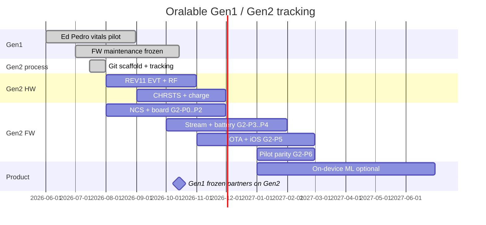

# Gen1 / Gen2 — living tracking board

**App working diagrams:** [MOBILE_APP_FLOWS.md §2](../../oralable_swift/docs/MOBILE_APP_FLOWS.md#2-how-the-patient-app-works--phase-0)

**Owner:** John Cogan · **Updated:** 2026-11-22
**Policy:** Single repo, multi-board — **do not fork**. Gen2 board, config, and firmware are a port of Gen1, but Gen2 is an evidence-gated non-release program. See [GEN1_GEN2_MIGRATION.md](./GEN1_GEN2_MIGRATION.md) · [PCB00003_GEN2_REV11_HARDWARE.md](./PCB00003_GEN2_REV11_HARDWARE.md) · [GEN2_PROGRAM_GATE.md](../../oralable_nrf/docs/GEN2_PROGRAM_GATE.md) · **[PRODUCT_ROADMAP.md](./PRODUCT_ROADMAP.md)** · **[VERSION_ALIGNMENT.md](./data_room/VERSION_ALIGNMENT.md)** · **[COST_AND_TIMELINE.md](./data_room/governance/COST_AND_TIMELINE.md)** · [FIGURES.md](./FIGURES.md)

**Current control state (22 Nov 2026):** John reports the board is on **2.0.8-gen2**. The firmware string is **2.0.8-gen2-nrfconnect**. G2-P2, G2-P3, G2-P4, and G2-P6 were reviewed on **2.0.6**, not on 2.0.8. Source on `main` signs **2.0.8+0** and broadcasts **MAM**. `app/VERSION` **1.0.87** is not the Gen 2 string. Kits stay gated. The iOS app is not production-compatible. The `pcb00003` tree remains the Gen 1 archive.


**Strategy stack:** Stage A wellness wearable → Stage B medical (later) · new US patent embodiment · Ed/Pedro = patient app only.  
**Cost & timeline (planning):** [COST_AND_TIMELINE.md](./data_room/governance/COST_AND_TIMELINE.md) — Phase 0 continues past Sep 2026 (30 Sep handoff missed); Phase 1+ Q4’26–Q1’27; Gen2 parallel; Stage B H2’27–2028. Mid Stage A ~€200–250k; Stage A+Gen2 ~€350–450k; through Stage B ~€0.8–1.0M (ranges — not a budget).

---

## 1. Git map (active)

| Track | Repo | Branch / tag | Board | FW string | Status |
|-------|------|--------------|-------|-----------|--------|
| **Gen2 bring-up** | `oralable_nrf` | `main` | `pcb00003_gen2` | Board **2.0.8-gen2**. Source signs **2.0.8+0**, name **MAM** | John, 22 Nov 2026. Gates were reviewed on **2.0.6**, not on 2.0.8. Kits stay gated. The iOS app is not production compatible. |
| **Gen1 archive** | `oralable_nrf` | `pcb00003` tree | `pcb00003` | **1.0.85** frozen | **Frozen.** Source for the port. No new 1.0.x. |
| **Gen1 prior** | `oralable_nrf` | tags `v1.0.66` | `pcb00003` | `1.0.66` | Rollback only |
| **Docs / research** | `cursor_oralable` | `main` | — | docs hub **1.3.21** / data_room **1.1.75** | Tracking live |
| **iOS / Core** | `oralable_swift` · `OralableCore` | current | — | App **4.3.3** · Gen1 gate min **1.0.63** / recommend **1.0.85** | No Gen2 fork and no production-compatibility claim. G2-P6 phone log reviewed 16 Nov 2026 on the MAM Diagnostics build, app 4.3.3 (build 5). |

### Rules (non-negotiable)

1. **Port, do not rewrite.** Gen 2 uses the Gen 1 application (`app/`), the Gen 1 GATT, and the Gen 1 sensor and charge behavior. As at 22 Nov 2026 the source broadcast name is **MAM**. Images through 2.0.7 were built to say **Oralable**. The phone accepts both. The new file is `boards/byteexplain/pcb00003_gen2/`: same nets (SDA, SCL, INT_ACC, INT_OPT, SENS_EN, CHRSTS, BATEN, BATVOL), new nRF54 pins. Do not invent a second protocol.
2. Keep `west build -b pcb00003` building. That tree is the archive the port copies from. No new Gen 1 features.
3. Gen 2 source is on **`main`**. A candidate build is not a release. G2-P2, G2-P3, G2-P4, and G2-P6 are reviewed on 2.0.6. Kits stay gated. The iOS app is not production-compatible.
4. Artifacts must encode board + version:
   - Gen1: `artifacts/oralable_1.0.70_pcb00003_merged.hex`
   - Gen2: a local candidate may encode board + version, but it must remain outside release artifacts until the program gate is formally closed.
5. Do **not** create `oralable_nrf_gen2` (or fork iOS / Core / Python).

### Tag conventions

| Tag | Meaning |
|-----|---------|
| `v1.0.66` | Gen1 prior ship (rollback hex) |
| `v1.0.70` | Gen1 archive — STAT blink dock + 1.0.67/1.0.68 lineage |
| `v1.0.85` | Gen1 **frozen** archive (last kit string). Not the current partner stack. |
| `v2.0.0-gen2-g2p0` | Possible reviewed G2-P0 evidence snapshot, never a release tag |
| `v2.0.0-gen2-g2p3` | Possible reviewed stream-parity evidence snapshot, never a support or release claim |

---

## 2. Timeline (calendar)

| Window | Track | Milestone | Exit |
|--------|-------|-----------|------|
| **2026-06 → 2026-08** | Gen1 | Ed/Pedro vitals pilot (REV10 / BOM REV8) | Phase 0 success criteria |
| **2026-10-14** | Product | Gen 1 frozen. Partners move to Gen 2. | Written here |
| **2026-10-14 →** | Gen2 FW | Port Gen 1 app + `prj.conf` onto `pcb00003_gen2` | G2-P0…P6 |
| **2026-07 → 2026-08** | Gen2 | Git scaffold + board stub + tracking | Branch exists; this doc live |
| **2026-08 → 2026-10** | Gen2 HW | REV11 EVT + RF/antenna bench | RSSI A/B vs Gen1 |
| **2026-08 → 2026-11** | Gen2 FW | NCS bump + `pcb00003_gen2` DTS (G2-P0…P2) | Advertise + `006` |
| **2026-09 → 2026-11** | Gen2 HW | CHRSTS + charge on REV11 | Byte0 or manual mode validated |
| **2026-10 → 2027-01** | Gen2 FW | GATT stream parity (G2-P3…P4) | 50 Hz ±/ACC |
| **2026-11 → 2027-02** | Gen2 FW | OTA + iOS soak (G2-P5) | Device Manager swap |
| **2027-01 → 2027-02** | Gen2 | Pilot parity (G2-P6) | Temple vitals gates |
| **2027-01 → 2027-06** | Gen2 | Optional on-device ML | Research gate |
| **2026-10-14 →** | Gen2 controlled bench work | Evidence-gated hardware procedure | No generic Gen1 flash helper; G2-P0 evidence must be reviewed before status changes. |

**Figures:** [FIGURES.md](./FIGURES.md)



---

## 3. Phase checklist (firmware)

Update status: `pending` → `in_progress` → `done` · put date in Notes.

| Phase | Goal | Exit gate | Status | Notes |
|-------|------|-----------|--------|-------|
| **G2-P0** | NCS + board identity/pins + SWD + RTT | Controlled program/verify/reset/RTT record tied to approved pin map | pending | Pin map written 9 Nov 2026 from the DTS. Raw SWD verify log is not in the repo. Reviewer has not accepted it. |
| **G2-P1** | I²C WHO_AM_I ACC + PPG | Sensor IDs in RTT | pending | Recorded as LIS2DTW12 `0x44` and MAXM86161 `0x36`. Raw RTT file is not in the repo. |
| **G2-P2** | BLE advertise + GATT `006` | nRF Connect discovery | done | 15 Nov 2026. John reviewed `Oralable__61_.csv` on `2.0.6-gen2-nrfconnect`, commit `42a4605`. SHA-256 `5caf5bd66371eb5354fa7bb51e1c61f89c769fb61c9cadcd44c88b87ffafefad`. |
| **G2-P3** | Stream PPG/ACC @ 50 Hz | Packet format, 50 Hz, and drop accounting on the Gen 2 capture | done | 15 Nov 2026. John reviewed `Oralable__62_.csv` on `2.0.6-gen2-nrfconnect`, commit `42a4605`. PPG 11 min 11 s and accelerometer 11 min 15 s, both 50 Hz, zero frame gaps. SHA-256 `31debe59c30390b225951d2032ffae3d48868dafeebef45f82e552430f542c4e`. |
| **G2-P4** | Battery + charge + LED | Architecture §3.3 scenarios | done | 15 Nov 2026. John reviewed `Oralable__63_.csv` on `2.0.6-gen2-nrfconnect`, commit `42a4605`. Off the case the pin was idle at 4213 mV. Back on the case the log read `fw: bat led hold mv=4213`. SHA-256 `67058c7ce006b4c8dec370bf64fa31e89b51b8e8ab181f31b2e9866a976475af`. |
| **G2-P5** | MCUboot OTA | Device Manager signed swap | pending | New partitions |
| **G2-P6** | Pilot parity | Ed/Pedro-equivalent vitals | done | 16 Nov 2026. John reviewed `ios_gen2_before_gate_log_161126.txt` on `2.0.6-gen2-nrfconnect`. The phone streamed PPG at 50 Hz, then reconnected after the app closed the link. Oxygen estimates were mostly under 90 and flagged. Battery percent used the old 3.61–4.35 V scale. This is not an Ed/Pedro vitals claim. SHA-256 `1d289ed24259409aecf54cee4194c438c1f1288cce211ee271889076f23a60aa`. |

### Hardware / pinmux gates (before G2-P1)

| # | Item | Status |
|---|------|--------|
| H1 | Altium netlist → lock GPIO table in REV11 hardware doc | Hypothesis table retired 9 Nov 2026. The map is the DTS. Reviewer has not accepted it. |
| H2 | Confirm 100 µF bulk on REV11 | pending |
| H3 | LTC4124 ISET strap for 30 mAh | pending |
| H4 | First REV11 continuity: SDA/SCL/CHRSTS/SENS_EN/BATEN/BATVOL | dropped 9 Nov 2026. Firmware identity reads are the G2-P1 record |
| H5 | RF soak cheek/temple vs Gen1 | pending |

### Gen1 protection gates

| # | Item | Status |
|---|------|--------|
| G1-1 | `west build -b pcb00003` green on Gen1 branch | active |
| G1-2 | Pilot hex in `docs/data_room/firmware/` matches tag | active (**1.0.70** shipping) |
| G1-3 | Placement docs: Automatic OK on 1.0.70+ | active |
| G1-4 | STAT blink + prior BLE/Bugbot lineage in **1.0.70** | **ship packaged**; RTT gate + TestFlight soak |

---

## 3b. Scheduled backlog (do-now vs later)

### Do next (blocks Ed/Pedro handoff on 1.0.70)

| # | Owner | Item | Exit |
|---|-------|------|------|
| S1 | John | Flash both kits **1.0.70** | `006` reads `1.0.70` |
| S2 | John | nRF Connect/RTT: blink→charge_active; taper→solid; undock→off | [FIRMWARE_1.0.70_FLASH.md](./data_room/archive/firmware_guides/FIRMWARE_1.0.70_FLASH.md) |
| S3 | John | TestFlight **4.3.3** soak: Automatic + Device LED | App pairs with 1.0.70 |
| S4 | John | Tag `v1.0.70` / `v1.0.70-ed-pedro` after S2 | G1-2 frozen |

### Later (not blocking Ed/Pedro on 1.0.70 kits)

| # | When | Item | Notes |
|---|------|------|-------|
| L1 | After pairing UX | `CONFIG_MCUMGR_TRANSPORT_BT_PERM_RW_AUTHEN` | Nordic production DFU auth |
| L2 | Post-pilot | In-app Device Manager / McuManager | OTA still via Nordic Device Manager |
| L3 | Gen2 | G2-P0…P6 + H1–H5 | See §3 phase checklist |
| L4 | Optional | Refresh `docs/archive/upload_2026-06/*` frozen pack | Or keep deprecated |
| L5 | Optional | ACC INT via DT `gpio_dt_spec` (parity with PPG) | ACC still hardcoded ACTIVE_HIGH |

---

## 4. How to work day-to-day

### Gen1 archive

No new features. The tree stays so the port has a source, and so a bench board can still be flashed the old way:

```bash
cd oralable_nrf
./scripts/flash_and_rtt.sh
```

### Gen2 bring-up

Copy the Gen1 app and `prj.conf`, then change board-specific mappings only after the REV11 pin evidence is reviewed. Candidate helpers never program hardware. Controlled bench work and all gate evidence are defined in [`oralable_nrf/docs/GEN2_PROGRAM_GATE.md`](../../oralable_nrf/docs/GEN2_PROGRAM_GATE.md).

```bash
cd oralable_nrf
git checkout feature/gen2-nrf54l15
./scripts/build_gen2_app.sh --ncs-root /path/to/ncs-v2.9.3 --toolchain /path/to/b8efef2ad5 --pristine
python3 scripts/verify_gen2_program.py
```

### After G2-P3 — candidate builds only

After G2-P3, retain both Gen1 and Gen2 build validation, but do not promote Gen2 merely because both compile. G2-P4 and G2-P6 are recorded on 2.0.6. The release flag is on for that candidate. Kits stay gated. The iOS app is not production compatible.

Helper: `oralable_nrf/scripts/gen2_status.sh`

---

## 5. Gen 1 — frozen 14 Oct 2026

Feature work has stopped. The decision is this cutover, not a 2027 review. `pcb00003` stays buildable as the source of the port. Partners are not shown Gen 1.

Still to prove on Gen2 through the evidence-gated program:

- [ ] G2-P0 RTT hello on the arrived MAM
- [ ] IR-DC band matches the Gen 1 baseline (`scripts/check_ir_dc_scaling.py`)
- [x] iOS reconnect at the temple, reviewed 16 Nov 2026 on 2.0.6
- [x] G2-P4 charge, reviewed 15 Nov 2026 on 2.0.6

---

## 6. Changelog (process)

| Date | Change |
|------|--------|
| 2026-07-16 | `app/VERSION` → **1.0.67**; dropped misplaced `CONFIG_BT_DFU_SMP` (central client); iOS CCC timeouts + hang fixes; scheduled backlog §3b |
| 2026-07-16 | Nordic/Apple align documented: adv `.recycled`, iOS awaited CCC + status/battery readiness, explicit MCUmgr Kconfigs (SMP auth deferred) |
| 2026-07-22 | Pilot ship aligned to **1.0.70** + app **4.3.2**; STAT blink dock; prior 1.0.67/1.0.68 lineage folded in |
| 2026-07-24 | Milestone: app **4.3.3** (build 4) · Temporalis MAM Mac Protocol A retrain · night-report PDF path |
| 2026-07-26 | Docs align: hub **1.3.15** / data_room **1.1.42** · overnight bands + Core ML cohort · PRODUCT_ROADMAP §3 canonical timeline (Phase 0 gated; eng overnight shipped early) |
| 2026-07-27 | Docs **1.3.16** / data_room **1.1.47** · Gemini temple-PPG avenues → PRODUCT_ROADMAP §2b · landscape §4b |
| 2026-07-16 | Tracking board created; `feature/gen2-nrf54l15` @ `c378a89` + `pcb00003_gen2` stub; no-fork policy locked |
| 2026-10-14 | Historical Gen2 migration plan recorded. The later evidence-gate policy supersedes the earlier generic-install wording. |
| 2026-10-23 | Historical bench note: advertiser **Oralable-G2** was observed in nRF Connect. It did not establish TGM GATT, sensor streams, iOS support, update safety, or a passed gate; it must be re-captured under the evidence program. |
| 2026-11-01 | Gen2 program gate added: two non-release candidate tracks, pinned SDK/toolchain checks, and explicit G2-P0…P6 evidence requirements. |
