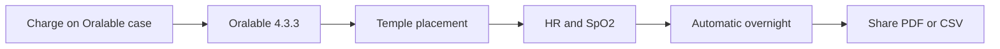

# Oralable — Ed & Pedro quick start (Phase 0 Vitals)

**One page · 7 Sep 2026 · Heart rate + SpO₂ on temple (extraoral · temporalis)**  
**Kit program:** [ORALABLE_RESEARCH_KIT.md](./ORALABLE_RESEARCH_KIT.md) — Oralable-only Beacon box · first worn session is this vitals path · sendable [PEDRO_STATUS_UPDATE_2026-09.md](./PEDRO_STATUS_UPDATE_2026-09.md)

**Partners:** [Dr Edward Owens](https://beaconconsultantssleephealthclinic.ie/team-member/dr-edward-owens/) · [Dr Pedro Mayoral Sanz](https://beaconconsultantssleephealthclinic.ie/team-member/dr-pedro/) — Beacon Consultants Sleep Health Clinic  
**Living bench (30 Oct):** [GEN2_WOUT_KAGA_STATUS_2026-10-30.md](../hardware/GEN2_WOUT_KAGA_STATUS_2026-10-30.md). The Gen 1 test plan is archived. Checklist: [PILOT_DRY_RUN_CHECKLIST.md](./PILOT_DRY_RUN_CHECKLIST.md). Hardware: [VITALS_PHASE_GEN1_GEN2.md](../../VITALS_PHASE_GEN1_GEN2.md) · Cost/timeline: [COST_AND_TIMELINE.md](../governance/COST_AND_TIMELINE.md)  
IEEE / McGill track: [COLLAB_NABAVI_MCGILL.md](./COLLAB_NABAVI_MCGILL.md) · **Figures:** [../FIGURES.md](../../FIGURES.md) · **App working diagrams:** [oralable_swift/docs/MOBILE_APP_FLOWS.md §2](../../../../oralable_swift/docs/MOBILE_APP_FLOWS.md#2-how-the-patient-app-works--phase-0)

**Support:** John Cogan (JAC / Oralable)

*Figure FIG-CO-003 — Temporalis clip placement (placeholder).*

*Figure FIG-CO-016 — Engineering Dual A flat-lay (includes ANR + headband). Beacon ship is Oralable + case + pads — not this full stack. Photo guide: [RESEARCH_KIT_PHOTO_SELECTION.md](./RESEARCH_KIT_PHOTO_SELECTION.md).*

*Figure FIG-CO-022 — Charge-to-temple pilot flow (placeholder).*

*Figure FIG-CO-013 — Charge case (coil align now; magnetic dock later). The SVG filename is historical.*

Full app diagrams: [MOBILE_APP_FLOWS.md §2](../../../../oralable_swift/docs/MOBILE_APP_FLOWS.md#2-how-the-patient-app-works--phase-0).

---

## Pilot ship status (as at 14 Oct 2026)

| Item | Status |
|------|--------|
| **Research Kits with Ed/Pedro** | **Not yet shipped** — **30 Sep 2026** handoff **missed**. Five Oralable-only kits. No new date. |
| **Build / flash / app** | **Gen 2** REV11 · patient app **4.3.3** (build **5**). Bench image written 29 Oct. Not kit firmware **2.0.x**. PPG and ACC do not stream. Not ready to hand off. |
| **Ship gate** | Gen 2 advertises and streams, then charge on the **Oralable charger** to a **temple-ready SOC** (target **≥50%**) and hold a short worn **HR + SpO₂** session without brownout |
| **Beacon use** | **One night** · **clinic** recharge · **no headband** · pad/tape · **no ANR** · ≥4 h (6 better) |
| **Charge behavior to port** | Same as frozen Gen 1 **1.0.85**: STAT blink = charging / on_dock; IR-pulse worn; sensors follow BLE; pad/desk recover; hold LED = rare pulse |
| **Still closing** | Sensor chips do not answer. Gen 1 firmware is not the fix. |
| **Gen 4** | Not this kit. Arrived boards are PPG plus accelerometer. |

**One-liner for partners:** *The kit is Gen 2. A bench image is on one board. The sensors do not stream. Kits stay gated. The 30 Sep handoff was missed. No new date.*

---

## What you are running

| Item | Version / note |
|------|----------------|
| **Firmware** | **2.0.x** non-release candidate. Port of Gen1. No hardware/iOS compatibility or kit-use claim until the reviewed G2-P0…G2-P6 evidence gate is complete; see `oralable_nrf/docs/GEN2_PROGRAM_GATE.md`. |
| **iOS app** | **Oralable 4.3.3** build **5** (TestFlight) — Protocol A Setup (**couple** seat QC) · vitals phase; FirmwareGate stays min **1.0.63** / recommend **1.0.85** until a Gen 2 unit advertises |
| **Hardware** | Gen 2 · BOM **REV9** · PCB **REV11** · Kaga **ES4L15BA1** · cell **LP270829** 35 mAh · Oralable charger (coil align now; magnetic dock later; **not Qi / MagSafe**) |

---

## What changed (vs Protocol B / older kits)

| Before | Now (Phase 0 · 1.0.85) |
|--------|-------------------------|
| Cheek + muscle / Protocol B | **Temple** + **HR / SpO₂ only** |
| Fit calibration required | **No user calibration** |
| “chrsts broken” / forced manual only | **STAT blink = on case**; **Automatic OK** on 1.0.70+ |
| Green LED on charger | Flash **green** below hold; **rare green pulse** in hold — never red (1.0.85). Archived 1.0.84 used solid green at taper |
| MagSafe / Qi pads | **Oralable case + USB-C only** |
| Battery % as fuel gauge | **Rough voltage estimate** (0% ≈ 3.61 V, 100% = 4.35 V) |

**Legacy kits on 1.0.66 / 1.0.70:** still work with the new app using **manual** or Automatic (1.0.70+). Prefer flash/OTA to **1.0.85** before Day 1 (1.0.84 still OK to connect).

---

## What’s in the kit

**Full program BOM:** [ORALABLE_RESEARCH_KIT.md](./ORALABLE_RESEARCH_KIT.md) (Oralable MAM + case + pads/tape + iOS). **ANR and headband are not in the Beacon box.** On day 1, every kit runs Phase 0 vitals below.

| Item | Notes |
|------|--------|
| Oralable Gen 2 MAM | Install with `flash_and_rtt.sh` once the port builds. No handoff hex today. |
| **Oralable charge case** | USB-C — line the coils up — **clinic** charge; magnetic dock is a later case; patient does not take the charger home |
| **ECG / Red Dot pads** (or tape) | Temple attach — **no headband** |
| iPhone + **Oralable** (patient) app | TestFlight **4.3.3** build **5+** · Protocol A Setup (**couple**) · vitals · 4 h+ one night |
| This sheet | Keep with the clip |

**Out of scope:** **Oralable for Dentists**, CloudKit share-to-dentist, practice IAP, ANR Dual A on the patient. Export CSV / PDF from the patient app only.

**Charging:** Clip + case are one BOM (ADI **LTC4124** RX coil / **LTC6990** TX coil). This build charges when the coils line up. A magnetic dock is a possible later case. **Not WPC Qi.**

**Wellness disclaimer:** Stage A wellness wearable validation — **not** a medical device.

---

## Critical: device placement

**Charge status** = LTC4124 **STAT** pattern (blink = charging; steady = taper/hold). Battery **%** is voltage-based and can read high on the pad — normal chemistry.

**Setup / Settings → Device placement** (applied on each BLE connect):

| Mode | When to use | LED |
|------|-------------|-----|
| **Automatic** | Preferred on **1.0.70+** + Oralable case | **≥1.0.85:** flash **green** below hold; **rare pulse** in hold. 1.0.70: red flash / solid red on taper |
| **On wireless charger** | Force “on case” if Automatic unclear | Same as Automatic |
| **Off charger (not worn)** | Table / off case | Status dark (FW ≥ 1.0.72) |
| **Worn on temple** | Vitals session | Status LEDs off; PPG red/IR is sensing, not status |

**Rules:**

1. Set placement **before** Connect when using manual modes (or leave **Automatic** on 1.0.70).
2. **Never** change placement while connected — disconnect first.
3. Use **Oralable case + USB-C** only — not MagSafe/Qi.

**App mirror:** Dashboard **Device LED** plus **Dock / Charging / Taper** chips. The physical LED is dim on purpose.

---

## Day 1 — Charge on case (3 steps)

1. Seat the clip on the **Oralable charge case** (USB-C) so the coils line up → placement **Automatic** (or **On wireless charger**) → **Connect**. Confirm FW reads **1.0.85** if shown.
2. Confirm **green flash** on FW ≥ 1.0.72 (1.0.70 kits: red flash), or app Charging + flash Device LED. Leave **30–60 min** (phone within ~30 cm).
3. When battery **≥50%**, ready for temple. % may step — watch the **trend**. After long charge, LED may go to a **rare green pulse** (~200 ms every 10 s) at hold (~4.20 V / 80%). STAT taper below hold stays **flash**. That is expected — STAT taper alone is not full. Never treat red as a status colour on current FW.

Re-open the app later: it should **auto-reconnect**. One attempt; wait ~20 s.

---

## Day 1+ — Temple vitals (4 steps)

1. **Remove from case** → Settings → **Worn on temple** → **Connect** (or stay Automatic only if you will remount immediately — preferred: set **Worn** explicitly).
2. Seat on **anterior temporalis** with **ECG pads or tape** (no headband). Clench once to find the bulge between eyebrow tail and ear. Dashboard → **On body**, then **Vitals ready** when signal is good (~30 s).
3. Confirm **Heart rate** and **SpO₂** (“Good signal” when stable). Short QC **≥5 min**, then **one night** (≥4 h; 6 h better).
4. Morning: return the device to clinic for recharge. **Share** → **Clinical Temporalis PDF**. Do **not** use Protocol B. Do **not** add ANR.

Keep phone nearby overnight.

---

## What to record and send back

After a Beacon night:

1. **Share** → **Export PDF — Clinical Temporalis Report** (primary). Short CSV is not enough for a 4 h night.
2. Email: attach method (pad/tape), FW string if known, disconnects, phone distance, battery %.
3. Optional: screenshot of vitals card + Device LED when **Vitals ready**.

Rename: `Oralable_NIGHT_Ed_YYYYMMDD.pdf` (or `Pedro_…`). Full SOP: [PAPER_A_DATA_HANDOFF_SOP.md](./PAPER_A_DATA_HANDOFF_SOP.md).

---

## LED quick reference (FW 1.0.85)

| Location | Condition | Device LED | App mirror |
|----------|-----------|------------|------------|
| On Oralable case | Charging / STAT blink or taper below hold | **Green flash** | Flash green · Charging |
| On Oralable case | Hold (~≥4.20 V / 80%) | **Rare green pulse** (~200 ms / 10 s) | Hold pulse |
| Table / bench | No BLE | Dark | LED off |
| On temple (worn) | Linked | PPG red/IR glow (status off) | LED off |

**1.0.70 kits only:** red flash / solid red on pad. Do not expect red on **1.0.85**. Archived **1.0.84** used continuous solid green at taper.

---

## Troubleshooting

| Symptom | Fix |
|---------|-----|
| On case but Dock/Charging off | Confirm **1.0.70**; wait one blink window (~few s); try **On wireless charger** then reconnect |
| Solid red on case before “100%” | Normal **taper** — current falling, not necessarily 4.2 V |
| Battery % jumps on pad | Voltage on wireless dock — watch **30 min trend** |
| “Firmware too old” | This kit is Gen 2. Do not flash Gen 1 **1.0.85** onto REV11. |
| App warns below recommended | The phone gate still names **1.0.85**. That is the old board. It is not a reason to load Gen 1 firmware. |
| No HR / SpO₂ | **Worn on temple**; adjust pressure; wait 30 s |
| Green on case | Placement still off-dock — set **On wireless charger** or **Automatic** on 1.0.70; reconnect |
| Red on table | Set **Off charger (not worn)** |
| BLE drops after Worn | Charge to **≥50%** first; phone **~30 cm**; RSSI **≥ −70 dBm** |
| MagSafe / Qi used | Stop — use **Oralable case only** |
| No LED (black clip) | Power-cycle; charge 10 min on case; contact John |

---

## Success criteria (Phase 0)

Ed and Pedro each complete:

- [ ] FW **1.0.85** confirmed (`3A0FF006` or app)
- [ ] 1× charger check (green flash → optional rare pulse in hold on **Oralable case**)
- [ ] 1× bench LED check (green off pad)
- [ ] 3× temple sessions (≥5 min) with HR and SpO₂ at least once
- [ ] 1× CSV export per session

Protocol B / overnight muscle study **deferred** until vitals stable.  
When overnight muscle evaluation starts: **≥ 6 h** worn (goal **8 h**). Review the **state hypnogram first** in the **patient app** (Dashboard morning card + Share preview — adapts [FIG-CO-025](../figures/FIG-CO-025-state-hypnogram-exemplar.png); **that asset is a ~6 min layout exemplar**, not an overnight). Or use Share → Clinical Temporalis PDF + Mac `generate_overnight_night_report.py`. Bands Low/Moderate/High per [OVERNIGHT_NIGHT_REPORT.md](../../OVERNIGHT_NIGHT_REPORT.md).

**Sign-off:** the Gen 1 list is archived — [VITALS_PILOT_TEST_PLAN.md § Sign-off](../archive/VITALS_PILOT_TEST_PLAN.md#sign-off). It is not the Gen 2 gate.
